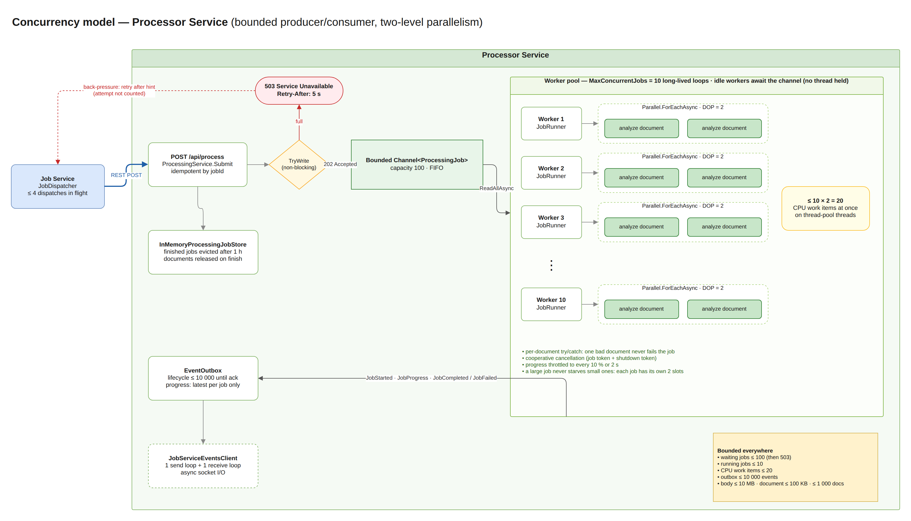
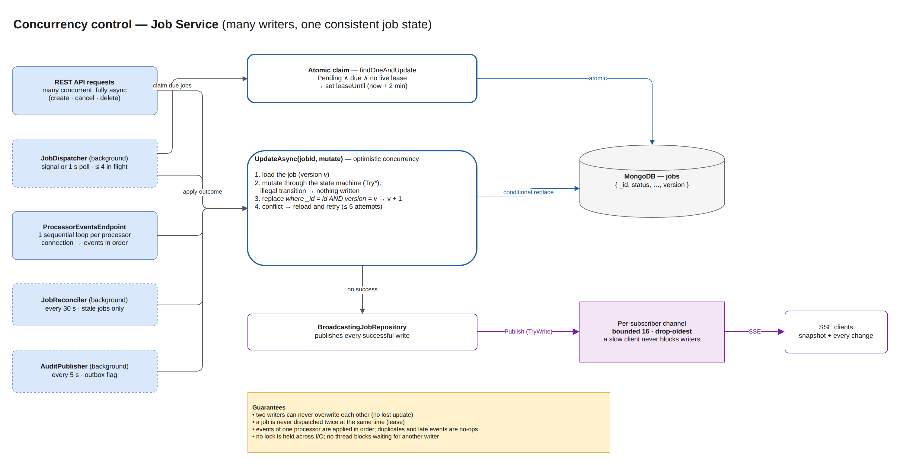

# Concurrency & Performance — TA9 Document Processing System

| | |
|---|---|
| **Assignment section** | §4 Concurrency & Performance |
| **Requirement** | Handle at least **10 jobs concurrently**, each with up to **1,000 documents**. Avoid **unbounded parallel work** and avoid **blocking threads** unnecessarily. Explain the chosen strategy, why, and its limits and trade-offs |
| **Chosen strategy** | **Bounded producer/consumer with two-level parallelism**: a bounded queue with backpressure, a fixed worker pool, a fixed per-job document parallelism, async I/O everywhere; on the Job Service side, optimistic concurrency, atomic leases and bounded fan-out |
| **Diagrams** | draw.io pages **7. Concurrency — Processor** and **8. Concurrency — Job Service** in `docs/hld/diagrams/ta9-hld.drawio` |

## 1. The requirement in numbers

| Dimension | Required | Designed for (defaults) |
|---|---|---|
| Jobs processed at the same time | ≥ 10 | **10** (`Processing:MaxConcurrentJobs`) |
| Documents per job | up to 1,000 | up to 1,000 (validated; 400 above) |
| Jobs accepted while all workers are busy | — | **100** waiting (`Processing:QueueCapacity`), then 503 + `Retry-After` |
| Documents analyzed at the same time | bounded | **≤ 10 × 2 = 20** (`MaxConcurrentJobs × DocParallelismPerJob`) |
| Blocked threads while waiting | none | none: workers, HTTP, WebSocket and storage I/O are all `async` |

## 2. The chosen method

### 2.1 Processor Service: where the work happens

The processor is a **bounded producer/consumer pipeline** with **two independent limits**.

1. **Admission (producer side).** `POST /api/process` validates the request and calls `Channel.Writer.TryWrite` on a **bounded `Channel<ProcessingJob>`** with capacity 100. `TryWrite` never blocks. If the channel is full the request returns immediately with **503 Service Unavailable + `Retry-After: 5`**, so overload is pushed back to the caller instead of piling up in memory. Submissions are **idempotent by `jobId`**: a retried dispatch returns the existing job (200) instead of queuing it twice.
2. **Job-level concurrency (consumer side).** `JobWorkerService` starts **`MaxConcurrentJobs` (10) long-lived worker loops**. Each loop does `await foreach (var job in channel.Reader.ReadAllAsync(...))`. An idle worker is a suspended async state machine, not a thread, so 10 idle workers cost no threads at all.
3. **Document-level concurrency (inside a job).** Each worker runs `JobRunner`, which processes the job's documents with **`Parallel.ForEachAsync` and `MaxDegreeOfParallelism = DocParallelismPerJob` (2)**. The analysis itself (tokenize, count, SHA-256) is pure CPU work with no I/O, so it runs on thread-pool threads for a few milliseconds per document.
4. **The resulting bound:** at most **10 jobs × 2 documents = 20 CPU work items** run at any moment, whatever the number of submitted jobs or documents.

Surrounding guarantees:
- **Failure isolation:** each document is analyzed inside its own `try/catch`, so one failing document is reported as failed and never stops the job. A worker survives any exception thrown by a job.
- **Cooperative cancellation:** every job has a `CancellationToken` linked with the host's shutdown token. A cancel request or shutdown stops the job between documents without killing threads.
- **Thread-safe job state:** `ProcessingJob` transitions (`TryStart`, `TryComplete`, `TryCancel`, …) run under a short lock that is never held across I/O. The processed-documents counter uses `Interlocked`.
- **Bounded memory:** document content is released as soon as a job finishes, finished jobs are evicted after 1 hour, the event outbox holds at most 10,000 lifecycle events, and progress events are coalesced to the latest one per job.
- **Throttled progress:** progress is reported at most every 10% or every 2 seconds, so 1,000 documents produce about 10 progress events, not 1,000.

### 2.2 Job Service: many writers, one consistent state

The Job Service does little CPU work, but many components update the same job concurrently: API requests (cancel, delete), the dispatcher, the WebSocket event handler, the reconciler and the audit publisher. Its concurrency strategy is about **correctness under concurrent writers** and **bounded fan-out**.

| Mechanism | What it does | Why |
|---|---|---|
| **Optimistic concurrency** (`UpdateAsync`) | Load the job (version *v*), mutate it through the state machine, replace it only if the stored version is still *v*; on conflict reload and retry (up to 5 times) | No lost updates, no locks held across I/O, works across processes and instances |
| **Atomic claim with a lease** | The dispatcher claims a due `Pending` job with one `findOneAndUpdate`, which sets `leaseUntil` (2 min) | A job is never dispatched twice at the same time, even with several dispatchers; a crashed dispatch is retried automatically when the lease expires |
| **Bounded dispatch batches** | At most `MaxParallelDispatches` (4) HTTP dispatches in flight; woken immediately by a signal when a job is created, otherwise polls every second | Bounded outbound load; low latency without busy polling |
| **Sequential handling per WebSocket connection** | Events from one processor are handled one at a time, in order, and acknowledged only after they are stored | Preserves the sender's order (Started → Progress → Completed) without locks |
| **Persisted retry state** | `dispatchAttempts`, `nextDispatchAt` and `leaseUntil` live in the job record | Retries never hold a thread waiting, and survive restarts |
| **Bounded SSE fan-out** | Each subscriber has its own channel of 16 snapshots, dropping the oldest when full | A slow client can never block writers or grow memory; it still receives the latest state |
| **Async storage access, fail-fast** | All MongoDB calls are `async`; server selection times out after 5 s | No request thread blocks on an unreachable database; clients get a fast 503 |

### 2.3 End-to-end backpressure

1. The client gets **201** immediately; work continues in the background.
2. The dispatcher sends **≤ 4** jobs at a time.
3. When the processor's queue is full it answers **503 + Retry-After**. The dispatcher reschedules the job for that time **without counting a failed attempt**, because this is load, not a fault.
4. The processor keeps at most 100 waiting + 10 running jobs and 20 concurrent analyses.
5. Results flow back over one WebSocket per processor, with at-least-once delivery and idempotent handling.

The system therefore **slows down gracefully under overload instead of failing or exhausting memory**.

### 2.4 Configuration knobs

| Setting (environment variable) | Default | Effect |
|---|---|---|
| `Processing__MaxConcurrentJobs` | 10 | Jobs processed at the same time (worker loops) |
| `Processing__DocParallelismPerJob` | 2 | Documents analyzed in parallel inside one job |
| `Processing__QueueCapacity` | 100 | Jobs accepted while all workers are busy (then 503) |
| `Processing__RetryAfterSeconds` | 5 | Back-off hint returned with 503 |
| `Dispatch__MaxParallelDispatches` | 4 | Concurrent dispatch requests from the Job Service |
| `Dispatch__PollInterval` | 1 s | Fallback poll when no new-job signal arrives |
| `Dispatch__LeaseDuration` | 2 min | How long a claimed job is invisible to other dispatchers |

**Sizing rule of thumb:** keep `MaxConcurrentJobs × DocParallelismPerJob` close to the number of CPU cores of the processor host when the analysis dominates, and scale out by running more processor instances.

## 3. Why this method: advantages

| # | Advantage | Explanation |
|---|---|---|
| A1 | **Explicit, provable bounds** | Every resource has a hard ceiling: waiting jobs (100), running jobs (10), CPU work items (20), outbox (10,000), request size (10 MB). Load can never create unbounded tasks, threads or memory. This is exactly the assignment's "avoid unbounded parallel work". |
| A2 | **No blocked threads** | Idle workers await the channel, admission uses non-blocking `TryWrite`, and all HTTP, WebSocket and MongoDB I/O is async. The only threads in use do actual CPU work. The thread pool stays healthy and API latency stays low under load. |
| A3 | **Backpressure instead of collapse** | A full queue returns 503 + Retry-After right away. The dispatcher honors it without counting a failure, so overload slows throughput but never fails jobs or exhausts memory. |
| A4 | **Fairness between jobs** | Each running job gets its own small parallelism slice, so a 1,000-document job cannot starve a 5-document job. With one global "all documents" pool, a single big job could monopolize every slot. |
| A5 | **Right tool for CPU-bound work** | `Parallel.ForEachAsync` with a fixed degree of parallelism is the idiomatic .NET way to run bounded CPU work: no manual thread management, cancellation built in. |
| A6 | **Simple and standard** | Built only on `System.Threading.Channels` and the TPL, both in-box. No extra framework (TPL Dataflow, Rx, actors), so the code is short, readable and easy to explain and test. |
| A7 | **Tunable without code changes** | All limits are configuration values and can be adapted per environment or host size. |
| A8 | **Correct under concurrent writers** | Optimistic concurrency plus atomic leases give consistency without locks or distributed locks, and the design already works with more than one Job Service instance at the storage level. |
| A9 | **Testable** | The bounds are asserted by tests: an analyzer that measures maximum concurrency verifies ≤ DOP per job (`JobRunnerTests`), ≤ jobs × DOP overall (`JobWorkerServiceTests`) and ≤ 20 in the full system with 10 × 1,000 documents (`EndToEndTests`). |

## 4. Alternatives considered

| Alternative | Why it was not chosen |
|---|---|
| `Task.WhenAll` over all documents of all jobs | **Unbounded:** 10 jobs × 1,000 documents = 10,000 concurrent tasks; thread-pool starvation and memory spikes. This is exactly what the assignment forbids. |
| `Task.Run` per job, no queue | Unbounded number of running jobs and no backpressure: memory grows with load, and overload turns into timeouts instead of a clear 503. |
| `BlockingCollection` + dedicated threads | Each idle consumer **blocks a thread**, and threads are expensive. Channels give the same producer/consumer semantics asynchronously. |
| One global `SemaphoreSlim(Environment.ProcessorCount)` for all documents | Caps CPU work exactly, but adds contention on one semaphore and loses fairness: the first big job can take every slot. It remains an option for a dedicated CPU-limited deployment (see §6). |
| TPL Dataflow (`ActionBlock` with `BoundedCapacity`) | Equivalent semantics, but an extra package and a heavier API for a two-stage pipeline. Channels + `Parallel.ForEachAsync` express the same bounds more explicitly. |
| PLINQ `AsParallel()` | Synchronous and blocking, and parallelism is harder to control and cancel per job. |
| Message broker (RabbitMQ/Kafka) + horizontal scale | The right next step at larger scale (durable queue, consumer groups), but explicitly out of scope for the assignment and unnecessary for 10 × 1,000. |
| Pessimistic locks / distributed locks on jobs | Locks held across I/O hurt throughput and need lock-expiry handling. Optimistic concurrency fits the workload: conflicts are rare and cheap to retry. |

## 5. Limitations and trade-offs

| # | Limitation | Impact | Mitigation |
|---|---|---|---|
| L1 | **CPU oversubscription on small hosts** | 20 parallel analyses on a 4-core machine means more runnable work than cores; each document takes slightly longer. Throughput is still correct and fair. | Set `MaxConcurrentJobs × DocParallelismPerJob ≈ cores`, or add a global CPU limiter (see §6). |
| L2 | **In-memory queue in the processor** | Waiting and running jobs are lost if the processor restarts. | The Job Service's reconciler detects the lost jobs (404) and redispatches them; analysis is deterministic, so redoing it is safe. Production would use a durable broker. |
| L3 | **Memory ceiling is high in the worst case** | Up to 100 waiting jobs × 10 MB of content is about 1 GB in the extreme case; typical jobs are far smaller. | Lower `QueueCapacity`, or keep only document references in the queue (fetch content when processing). |
| L4 | **Fixed limits, not adaptive** | The same limits apply whether the host is idle or busy with other work. | Expose metrics (queue depth, in-flight work) and tune, or implement adaptive concurrency. |
| L5 | **Dispatch batches have head-of-line blocking** | The dispatcher waits for a whole batch (≤ 4) before claiming more; one slow dispatch delays the next batch by up to the HTTP timeout. | Small batches and timeouts keep the effect bounded; a continuous semaphore-based pipeline would remove it. |
| L6 | **Large completion messages** | A `JobCompleted` event for 1,000 documents is about 0.5 MB on the WebSocket (16 MB cap). | Fine for the target size; for bigger jobs stream results or fetch them via REST. |
| L7 | **Per-instance SSE fan-out** | Subscribers only see updates written by the same Job Service instance. | Single instance by design; multi-instance needs Redis pub/sub or a broker. |
| L8 | **Performance verified functionally, not benchmarked** | Tests prove completion, exactly-once analysis and the concurrency bound, but there is no automated latency/throughput threshold. | `scripts/smoke-test.ps1 -Jobs 10 -Documents 1000` measures elapsed time manually; production would add load tests and SLO alerts. |

## 6. Possible improvements for production

- **Global CPU limiter** (`SemaphoreSlim(ProcessorCount)`) shared by all jobs, keeping fairness with a small per-job cap.
- **Durable queue** (RabbitMQ/Kafka) and several processor instances (competing consumers) instead of REST dispatch + in-memory channel.
- **Metrics:** queue depth, running jobs, in-flight analyses, 503 rate, dispatch latency, outbox size (OpenTelemetry).
- **Adaptive concurrency** driven by CPU usage or latency.
- **Streaming results** (or REST pull) for very large jobs, and content by reference instead of inline.
- **Continuous dispatch pipeline** (semaphore instead of batches) to remove head-of-line blocking.

## 7. Tests for this section

The complete catalog of the system's tests, with strategy, environment, traceability and results, is the **Software Test Description (STD)** — `docs/testing/TA9-STD.docx` (Markdown: `docs/testing/STD.md`). This chapter lists only the tests that verify **§4 Concurrency & Performance**. The **STD ID** column is the identifier of the same test case in the STD, so each test can be looked up there; *Theory ×N* runs N data rows, *×2 stores* runs against InMemory and MongoDB.

### 7.1 What is verified

| Claim in this document | Verified by (STD IDs below) |
|---|---|
| Documents of one job never exceed `DocParallelismPerJob` | `JobRunnerTests.Never_exceeds_document_parallelism` |
| Total concurrent analyses never exceed `MaxConcurrentJobs × DocParallelismPerJob` | `JobWorkerServiceTests.Processes_many_jobs_with_bounded_total_concurrency`; E2E with 10 × 1,000 documents (≤ 20) |
| The queue is bounded; overload returns 503 + Retry-After and is honored without counting a failure | `ChannelJobQueueTests`, `ProcessingServiceTests`, `ProcessApiTests`, `HttpProcessorClientTests`, `JobDispatcherTests.Busy_processor…` |
| No lost updates between concurrent writers; a job is never dispatched twice at once | `JobRepositoryContract` (InMemory + MongoDB), `JobRepositoryExtensionsTests` |
| Failures, cancellation and shutdown never break the worker pool | `JobRunnerTests`, `JobWorkerServiceTests`, `ProcessingJobTests` |
| Slow consumers never block producers; per-connection ordering | `InMemoryJobUpdateBroadcasterTests`, `ProcessorEventsEndpointTests` |
| **The assignment scenario: 10 concurrent jobs × 1,000 documents** | **E2E test below** and manual **MT-03** |

### 7.2 Automated tests

| STD ID | Test case | Test class | Level | Kind |
|---|---|---|---|---|
| PS-032 | Never exceeds document parallelism | `JobRunnerTests` | Unit | Theory ×2 |
| PS-033 | Publishes throttled progress | `JobRunnerTests` | Unit | Fact |
| PS-027 | Isolates a failing document | `JobRunnerTests` | Unit | Fact |
| PS-030 | Stops when cancelled mid run without reporting completion | `JobRunnerTests` | Unit | Fact |
| PS-031 | Abandons job silently on shutdown | `JobRunnerTests` | Unit | Fact |
| PS-034 | Processes many jobs with bounded total concurrency | `JobWorkerServiceTests` | Unit | Fact |
| PS-035 | A crashing job does not kill the worker | `JobWorkerServiceTests` | Unit | Fact |
| PS-036 | Stops cleanly | `JobWorkerServiceTests` | Unit | Fact |
| PS-066 | Rejects when capacity is reached | `ChannelJobQueueTests` | Unit | Fact |
| PS-067 | Delivers jobs in fifo order and frees capacity | `ChannelJobQueueTests` | Unit | Fact |
| PS-058 | Rejects when queue is full and forgets the job | `ProcessingServiceTests` | Unit | Fact |
| PS-057 | Resubmitting the same job id is idempotent | `ProcessingServiceTests` | Unit | Fact |
| PS-062 | Reports every ten percent but not at completion | `ProgressThrottleTests` | Unit | Fact |
| PS-063 | Reports when the interval elapses between steps | `ProgressThrottleTests` | Unit | Fact |
| PS-065 | Out of order counts do not produce duplicate reports | `ProgressThrottleTests` | Unit | Fact |
| PS-052 | Cancel moves to cancelled and signals the token | `ProcessingJobTests` | Unit | Fact |
| PS-053 | Completion after cancel is ignored | `ProcessingJobTests` | Unit | Fact |
| PS-051 | Completes only from processing and releases documents | `ProcessingJobTests` | Unit | Fact |
| PS-069 | Removes only finished jobs older than cutoff | `InMemoryProcessingJobStoreTests` | Unit | Fact |
| PS-099 | Post returns 503 with retry after when queue is full | `ProcessApiTests` | Component | Fact |
| PS-095 | Post same job twice returns 200 the second time | `ProcessApiTests` | Component | Fact |
| PS-100 | Delete cancels a running job | `ProcessApiTests` | Component | Fact |
| JS-017 | Submit 503 is busy with the retry after hint | `HttpProcessorClientTests` | Unit | Fact |
| JS-056 | Busy processor delays the job without consuming an attempt | `JobDispatcherTests` | Unit | Fact |
| JS-061 | Dispatches in bounded parallel batches | `JobDispatcherTests` | Unit | Fact |
| JS-060 | A crashed dispatch is retried after the lease expires | `JobDispatcherTests` | Unit | Fact |
| JS-062 | Background loop dispatches new jobs when signalled | `JobDispatcherTests` | Unit | Fact |
| JS-037 | Concurrent updates never lose a write | `JobRepositoryContract` | Contract (InMemory + MongoDB) | Fact · ×2 stores |
| JS-035 | Update with a stale version is rejected | `JobRepositoryContract` | Contract (InMemory + MongoDB) | Fact · ×2 stores |
| JS-042 | Concurrent claims never hand out the same job twice | `JobRepositoryContract` | Contract (InMemory + MongoDB) | Fact · ×2 stores |
| JS-039 | Claim leases the due pending job until the lease expires | `JobRepositoryContract` | Contract (InMemory + MongoDB) | Fact · ×2 stores |
| JS-084 | Reloads and retries on conflict | `JobRepositoryExtensionsTests` | Unit | Fact |
| JS-085 | Gives up after max attempts | `JobRepositoryExtensionsTests` | Unit | Fact |
| JS-140 | Events are processed in order per connection | `ProcessorEventsEndpointTests` | Component | Fact |
| JS-091 | Slow subscriber keeps the latest snapshots and never blocks the publisher | `InMemoryJobUpdateBroadcasterTests` | Unit | Fact |
| E2E-002 | Ten concurrent jobs of 1000 documents complete with bounded parallelism | `EndToEndTests` | Integration (E2E) | Fact |

### 7.3 Manual test

| STD ID | Procedure | Expected result | Status |
|---|---|---|---|
| MT-03 | `powershell -ExecutionPolicy Bypass -File .\scripts\smoke-test.ps1 -Jobs 10 -Documents 1000` against the Docker Desktop stack | All 10 jobs Completed, 1,000 / 1,000 documents succeeded each | Passed (2026-10-26) |

All automated tests listed here passed in the latest full run (440 / 440, 2026-10-27).

