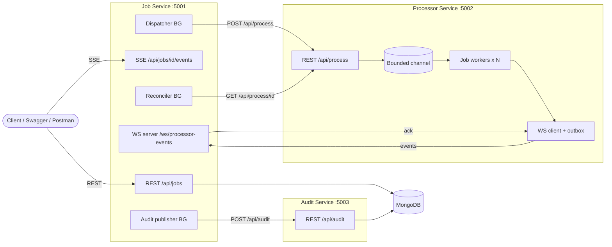
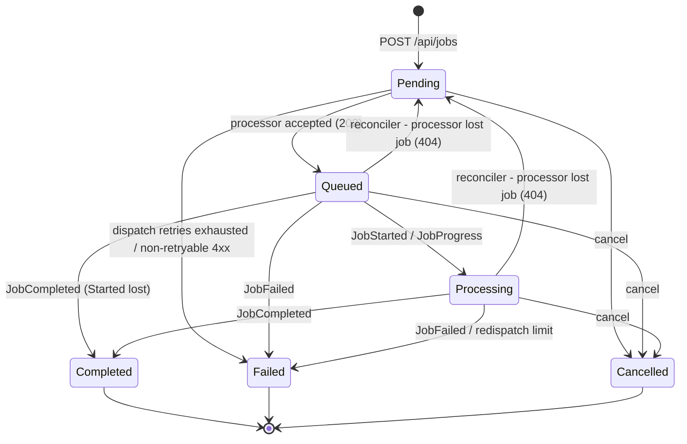
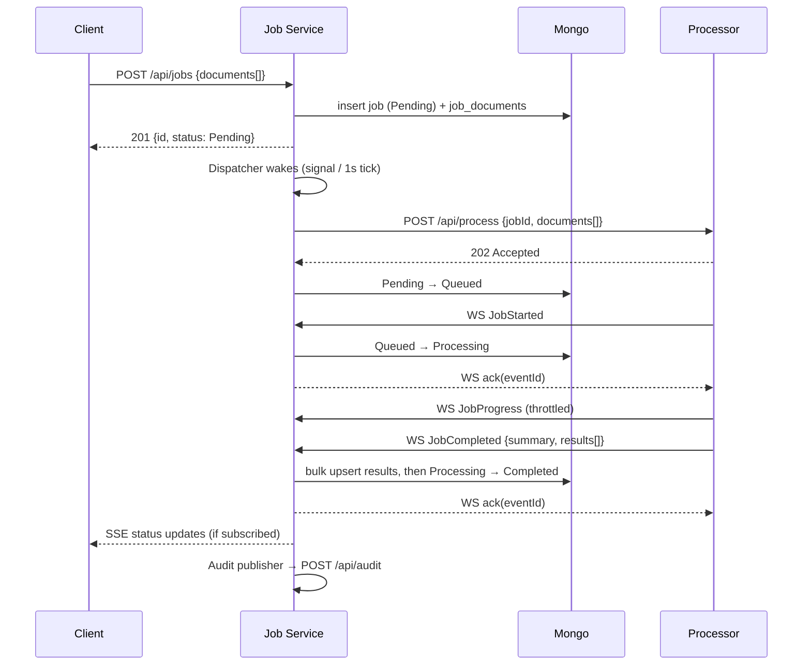

# 01 — Architecture

## 1. Goals

A small, readable backend made of cooperating services. They talk over REST and WebSocket, and the system stays correct under concurrency and partial failure. The business logic (text statistics) is deliberately trivial. The design effort goes into **flow, failure handling and boundaries**.

## 2. Components



| Service | Responsibility | State |
|---|---|---|
| **Job Service** | Public API, owns the job lifecycle (**source of truth**), dispatches work, consumes processor events, pushes SSE to clients, publishes audit summaries | MongoDB `ta9_jobs` (`jobs`, `job_documents`) |
| **Processor Service** | Stateless worker. Accepts work, analyses documents with bounded concurrency, reports lifecycle over WS | In-memory (results kept with TTL for reconciliation) |
| **Audit Service** (bonus) | Stores terminal job summaries, exposes them by jobId | MongoDB `ta9_audit` (`audit_entries`) |
| **Ta9.Contracts** (library) | DTOs shared across services: REST payloads and the WS event envelope | — |

**Database per service:** one Mongo instance runs in docker-compose, but each service owns its own database and never reads another's.

## 3. Job lifecycle



The core path is the one from the assignment, `Pending → Processing → Completed | Failed`. Two states were added, and each one exists for a reason:
- **Queued**: the processor has accepted the job but not started it yet. Without it, "dispatched but waiting in the processor queue" cannot be told apart from "not dispatched yet", and that distinction is exactly what the dispatcher and the reconciler need.
- **Cancelled**: the user cancelled. This is a different outcome from Failed, which means the system failed.

All transitions live in **one** place (`JobStateMachine`, used by the `Job` aggregate's `Try*` methods). Writes use **optimistic concurrency**: every job carries a `Version`, and an update succeeds only if the stored version is unchanged (otherwise reload, re-apply, retry). Concurrent writers (the WS handler, the reconciler, a cancel request) therefore can never overwrite each other or move a job backwards.

## 4. Main flows

### 4.1 Happy path



**Write order on completion:** the per-document results are written first and the job status second. A client that sees `Completed` is therefore guaranteed to find the results.

### 4.2 Processor unreachable

The dispatcher retries with exponential backoff and jitter (2s → 60s cap). After `MaxDispatchAttempts` (default 5) the job becomes `Failed` with `failureReason = "Processor unreachable"`. A `503` (queue full) is **not** counted as a failure attempt; it is retried after the `Retry-After` delay. Details in [03-reliability-and-concurrency.md](03-reliability-and-concurrency.md).

### 4.3 Lost events or a processor restart

The reconciler runs every 30s. It picks up jobs in `Queued`/`Processing` with no update for 60s and calls `GET /api/process/{id}`. A snapshot is applied through the **same** handler as the WS events, so both paths follow identical rules:
- **Completed/Failed:** apply the result, using the same handler as the WS event.
- **Still running:** refresh progress and `updatedAt` (liveness).
- **404:** the processor lost the job. Move it back to `Pending` (`redispatchCount++`) and wake the dispatcher. After 3 redispatches the job becomes `Failed`. The decision is re-checked under optimistic concurrency, so an event that arrives in the meantime wins.
- **Processor unreachable:** leave the job untouched; it is not the job's fault.

## 5. Code structure

```
src/
  Ta9.Contracts/            shared DTOs (REST + WS events), no logic
  Ta9.ServiceDefaults/      Serilog, correlation-id, ProblemDetails, health   ← see open item
  Ta9.JobService/
    Api/                    controllers, request validation, SSE, WS endpoint
    Application/            use-cases: JobCommands, ProcessorEventHandler, Dispatcher, Reconciler
    Domain/                 Job, JobStatus, JobStateMachine, DocumentResult
    Infrastructure/         Mongo + InMemory repositories, ProcessorClient, AuditClient
  Ta9.ProcessorService/
    Api/  Application/  Domain/ (DocumentAnalyzer)  Infrastructure/ (WS client, outbox, store)
  Ta9.AuditService/
tests/
  Ta9.JobService.Tests/  Ta9.ProcessorService.Tests/  Ta9.AuditService.Tests/
  Ta9.IntegrationTests/     cross-service E2E (Testcontainers Mongo, in-process hosts)
```

Dependency rule (enforced by convention and review, not by separate assemblies): `Api → Application → Domain`, and `Infrastructure` implements interfaces declared in `Application`/`Domain`. Swapping storage means adding a new `IJobRepository` implementation and changing one DI line.
