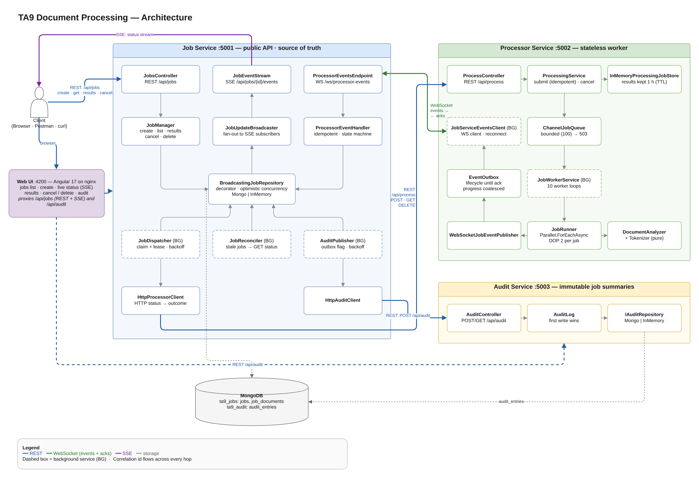
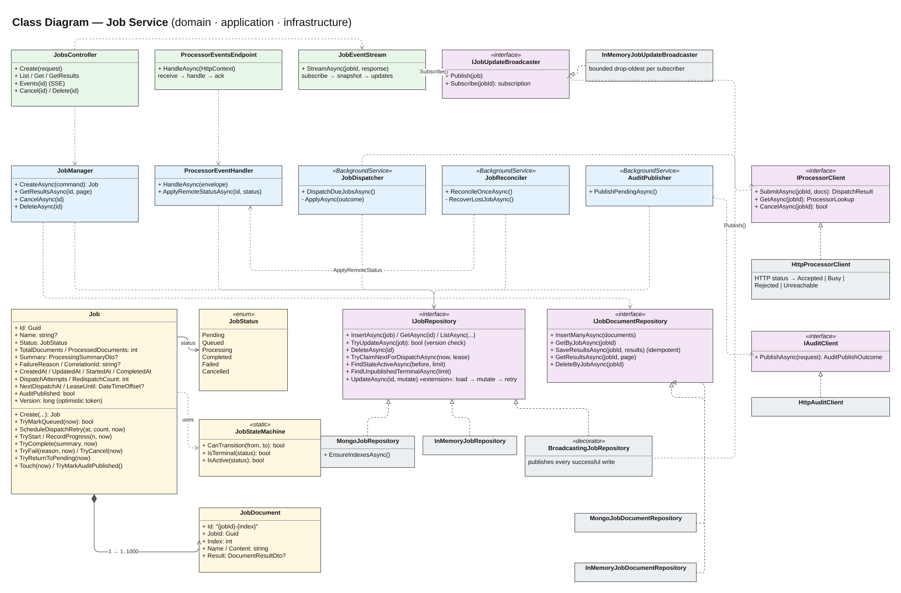
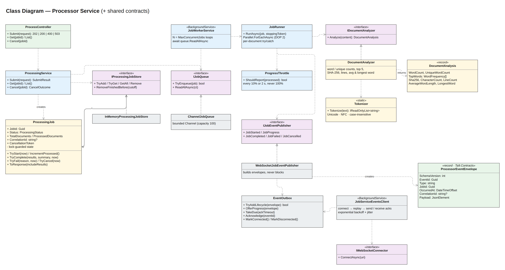
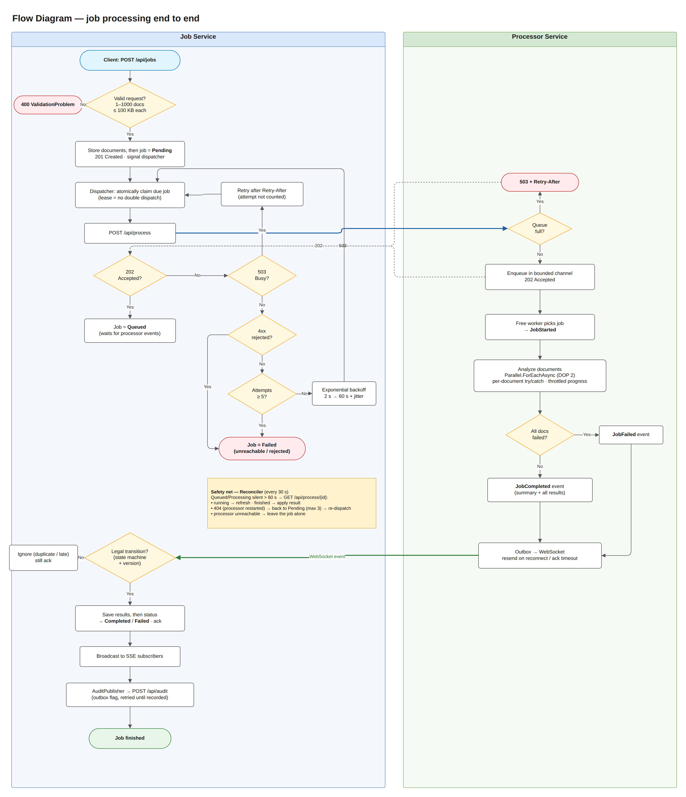
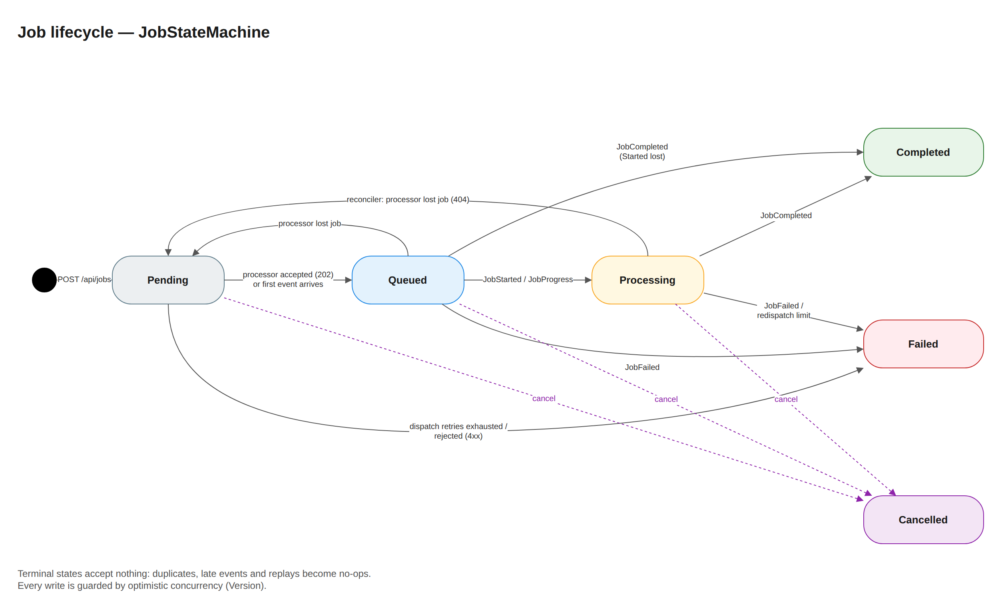
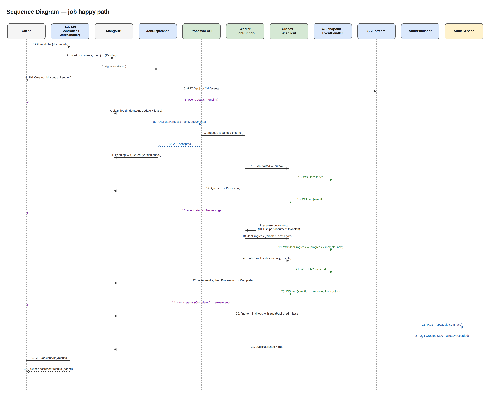
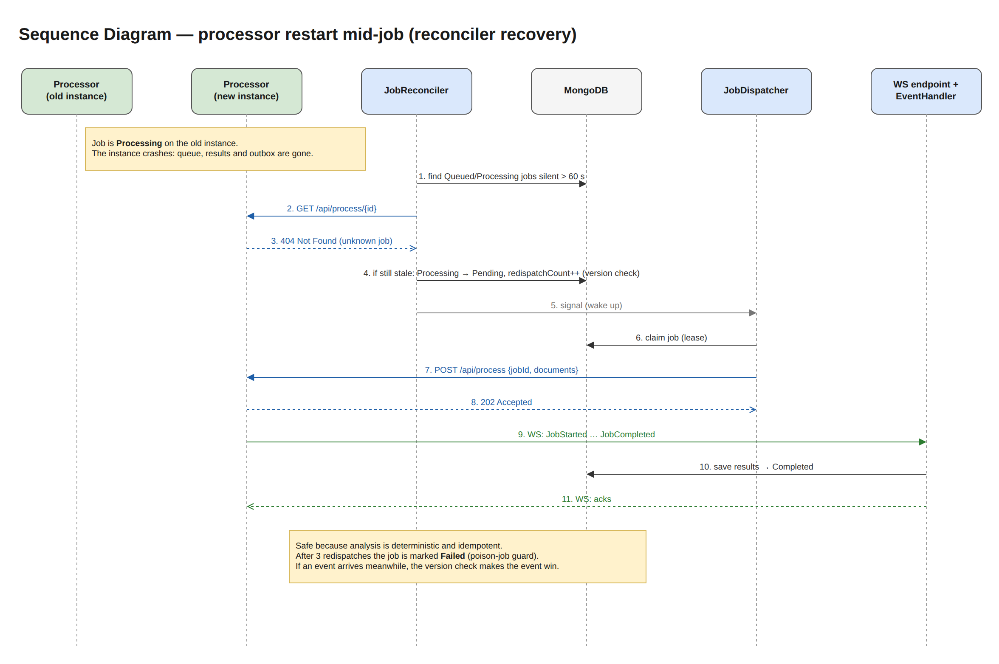
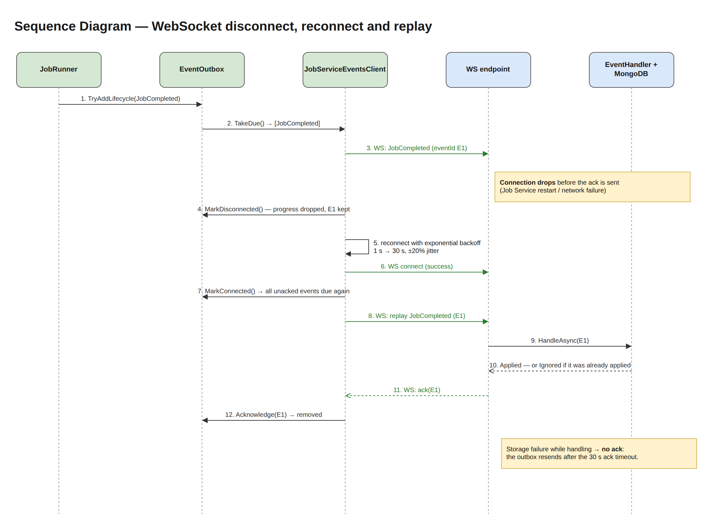
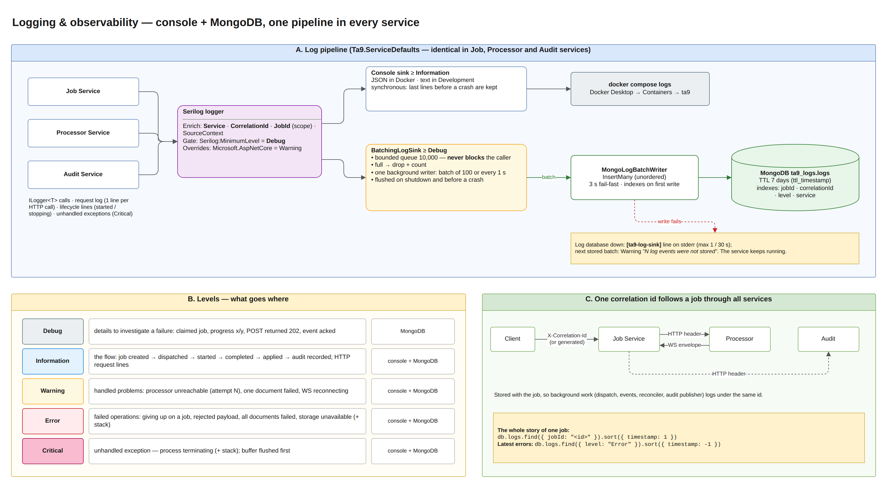
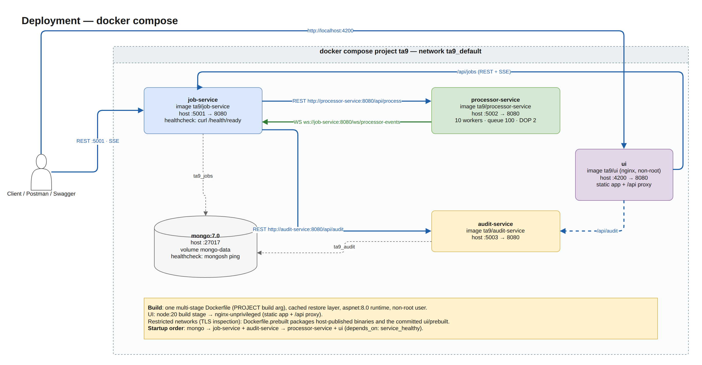

# High-Level Design — TA9 Real-Time Document Processing System

| | |
|---|---|
| **Document** | High-Level Design (HLD) |
| **System** | TA9 Document Processing (Job Service · Processor Service · Audit Service · Web UI) |
| **Stack** | C# / .NET 8 · ASP.NET Core · MongoDB 7 · Angular 17 + nginx (Web UI) · Docker Compose |
| **Diagrams** | Editable source: [`diagrams/ta9-hld.drawio`](diagrams/ta9-hld.drawio) (one page per diagram). Open with [app.diagrams.net](https://app.diagrams.net) or the VS Code *Draw.io Integration* extension. PNG renderings are in [`images`](images) |
| **Detailed design** | [`../design`](../design) — architecture, API contracts, reliability, decision log (D1–D29) |
| **Topic documents** | Concurrency (`../concurrency`), WebSocket behavior (`../websocket`), Storage (`../storage`), **Logging & Observability** (`../logging`), **Limitations & production roadmap** (`../limitations`) |

| draw.io page | Section |
|---|---|
| 1. Architecture | [§3 Architecture diagram](#3-architecture-diagram) |
| 2a / 2b. Class Diagram | [§5 Class diagrams](#5-class-diagrams) |
| 3. Flow Diagram | [§6 Flow diagram](#6-flow-diagram) |
| 4. Job State Machine | [§7 Job lifecycle](#7-job-lifecycle-state-machine) |
| 5a / 5b / 5c. Sequence | [§8 Sequence diagrams](#8-sequence-diagrams) |
| 6. Deployment | [§10 Deployment](#10-deployment) |
| 7 / 8. Concurrency | [§9.1 Concurrency and performance](#91-concurrency-and-performance) |
| 9. WebSocket — Connection & Outbox | [§9.2 Reliability](#92-reliability) |
| 10. Storage | [§5.1 Data model](#51-data-model-mongodb) |
| 11. Logging | [§9.4 Observability](#94-observability) |
| 12. Production Architecture | [§11 Risks, limitations and future work](#11-risks-limitations-and-future-work) |

---

## 1. Purpose and scope

The system accepts batches of text documents, analyzes them asynchronously and exposes progress and results in real time. For each document it computes:
- word count
- unique word count
- top-5 words
- SHA-256
- character count, line count, average word length and longest word

**In scope:** three services communicating over REST, WebSocket and SSE; a small web console (Angular) over the public REST API; bounded concurrent processing; failure handling (invalid input, unreachable services, restarts, lost or duplicate events); persistent storage; observability; automated tests; containerized deployment.

**Out of scope (by assignment):** authentication/authorization (considered, implemented and deliberately rolled back to keep the solution simple to run and review, D29), Kubernetes, message brokers, Redis, CI/CD. The assignment lists a frontend as optional; a simple one was added (D28).

## 2. Requirements and quality goals

| Category | Requirement | How the design meets it |
|---|---|---|
| Functional | CRUD-style job API, a simple lifecycle, per-document statistics | `/api/jobs`, state machine `Pending → Queued → Processing → Completed \| Failed` plus `Cancelled` |
| Integration | Job Service ↔ Processor over REST **and** WebSocket/SSE | REST dispatch; processor events over WS with acks; SSE to clients |
| Performance | ≥ 10 concurrent jobs × up to 1,000 documents; no unbounded parallelism; no blocked threads | Bounded channel (100) + 10 workers × 2 documents in parallel; async I/O; verified by an integration test |
| Reliability | Invalid input, processor unreachable, WS disconnects, duplicates | Validation (400), persisted retries with backoff, outbox + ack + reconnect, idempotent handlers, reconciler |
| Storage | Replaceable persistence | Repository interfaces; MongoDB and InMemory implementations selected by configuration |
| Observability | Meaningful logs for lifecycle, failures and retries (plus: logs in **MongoDB** and on the **console**, Debug / Information / Error levels) | One Serilog pipeline: console ≥ Information, MongoDB `ta9_logs.logs` ≥ Debug (batched, non-blocking, 7-day TTL); `Service` / `CorrelationId` / `JobId` on every record; health checks |

## 3. Architecture diagram

*draw.io page **1. Architecture***

### 3.1 Services and responsibilities

| Service | Responsibility | State | Talks to |
|---|---|---|---|
| **Job Service** | Public API. **Owns the job lifecycle** (single source of truth). Dispatches work, applies processor events, streams status (SSE), publishes audit summaries | MongoDB `ta9_jobs` (`jobs`, `job_documents`) | Processor (REST out, WS in), Audit (REST out), clients (REST, SSE) |
| **Processor Service** | Stateless worker: accepts work, analyzes documents with bounded concurrency, reports the lifecycle | In memory (finished results kept 1 h for reconciliation) | Job Service (WS client) |
| **Audit Service** | Stores immutable summaries of finished jobs | MongoDB `ta9_audit` (`audit_entries`) | — |
| **Web UI** (`ui/`, optional) | Browser console: list jobs, create jobs, follow a job live, results, cancel / delete, audit entry. **No logic of its own**: it only calls the public REST API | None (stateless; static files on nginx) | Job Service (REST + SSE), Audit Service (REST), both through its own nginx proxy |
| **Ta9.Contracts** (library) | Shared REST DTOs, WS event envelope and serializer, input limits | — | — |
| **Ta9.ServiceDefaults** (library) | Logging pipeline (Serilog → console + batched MongoDB sink), lifecycle / crash logging, correlation id, ProblemDetails, health endpoints, exponential backoff | MongoDB `ta9_logs` (`logs`, shared by all services) | MongoDB (logs) |

### 3.2 Communication

| From → To | Protocol | Purpose | Delivery semantics |
|---|---|---|---|
| Client → Job Service | REST | Create, list, get, results, cancel, delete | Synchronous; job processing is asynchronous |
| Browser → Web UI (nginx :4200) → Job / Audit Service | HTTP · REST · SSE | The same public API, proxied: `/api/jobs` → Job Service, `/api/audit` → Audit Service | One origin for the browser: no CORS, no change to the services; SSE proxied without buffering |
| Job Service → Client | **SSE** | Live status and progress per job | Snapshot + every change; stream ends at a terminal state |
| Job Service → Processor | REST | Dispatch (POST, idempotent by `jobId`), status (GET), cancel (DELETE) | Retries with persisted exponential backoff |
| Processor → Job Service | **WebSocket** | `JobStarted`, `JobProgress`, `JobCompleted`, `JobFailed`, `JobCancelled` + acks back | Lifecycle: **at-least-once** (outbox + ack). Progress: best effort |
| Job Service → Audit | REST | Terminal job summaries | At-least-once (outbox flag); idempotent receiver |

## 4. Component design

### 4.1 Job Service (layers: Api → Application → Domain ← Infrastructure)

| Component | Role |
|---|---|
| `JobsController`, `JobEventStream`, `ProcessorEventsEndpoint` | HTTP / SSE / WebSocket adapters |
| `JobManager` | Use cases: create (documents, then job: commit marker), results, cancel (propagated to the processor), delete (finished jobs only) |
| `JobDispatcher` (background) | Atomically claims due `Pending` jobs with a **lease**, sends them in bounded parallel batches, applies the outcome (Queued / retry after hint / backoff → Failed / Failed) |
| `ProcessorEventHandler` | Applies events and status snapshots through the state machine; results are stored before the status changes |
| `JobReconciler` (background) | Safety net for lost events and processor restarts |
| `AuditPublisher` (background) | Delivers terminal summaries; the `auditPublished` flag is the outbox |
| `Job`, `JobStateMachine` | Aggregate with `Try*` transitions; one transition table for the whole system |
| `IJobRepository` + `BroadcastingJobRepository` | Persistence with **optimistic concurrency** (`Version`). A decorator publishes every successful write to SSE subscribers |

### 4.2 Processor Service

| Component | Role |
|---|---|
| `ProcessController` / `ProcessingService` | Validate; idempotent submit (known `jobId` → 200); bounded enqueue (full → **503 + Retry-After**); cancel |
| `ChannelJobQueue` | Bounded `Channel<T>`, the backpressure point |
| `JobWorkerService` (background) | 10 long-lived worker loops awaiting the channel (no blocked threads) |
| `JobRunner` | `Parallel.ForEachAsync` with DOP 2 per job; per-document failure isolation; throttled progress; cooperative cancellation |
| `DocumentAnalyzer` + `Tokenizer` | Pure, deterministic analysis (Unicode, NFC, case-insensitive; ties broken alphabetically) |
| `EventOutbox` + `JobServiceEventsClient` | Lifecycle events kept until acked and replayed after reconnect or ack timeout; reconnect with backoff and jitter |

### 4.3 Web UI (Angular 17)

| Part | Role |
|---|---|
| `JobsApi` | Thin client over the REST API (relative URLs) and the SSE stream (`EventSource`, auto-reconnect) |
| `JobsListComponent` | `GET /api/jobs`: status filter, paging, auto-refresh every 3 s |
| `JobCreateComponent` | `POST /api/jobs`: typed text, `.txt` upload, or up to 1,000 generated sample documents; client-side hints only, the server validates |
| `JobDetailComponent` | Live status over SSE until a terminal state; cancel / delete; paged results; polls the audit entry until it is recorded |
| `describeError` | Shows ProblemDetails / ValidationProblemDetails (field errors) as one readable message |
| `nginx.conf` | Serves the static build and proxies `/api/jobs` and `/api/audit`; SSE without buffering; 11 MB body limit |

Standalone components, signals, the `@if` / `@for` control flow; plain CSS, no UI library. Tests: 21 component tests (STD §7.6).

## 5. Class diagrams

*draw.io pages **2a. Class Diagram — Job Service** and **2b. Class Diagram — Processor Service***

### 5.1 Data model (MongoDB)

| Collection | Key | Main fields | Indexes |
|---|---|---|---|
| `jobs` | `_id` = job id (string GUID) | status, counters, summary, timestamps, dispatch bookkeeping (`dispatchAttempts`, `nextDispatchAt`, `leaseUntil`, `redispatchCount`), `auditPublished`, `version` | `{status, nextDispatchAt}` (dispatcher) · `{status, updatedAt}` (reconciler) · `{auditPublished, status}` (audit) · `{createdAt: -1}` (listing) |
| `job_documents` | `_id` = `"{jobId}-{index}"` | jobId, index, name, content, result | `{jobId, index}` unique |
| `audit_entries` | `_id` = job id | status, counts, total words, failure reason, timestamps, `recordedAt` | — |
| `ta9_logs.logs` | ObjectId | timestamp, level, service, host, message, messageTemplate, sourceContext, `correlationId`, `jobId`, exception, properties | **TTL** `{timestamp}` 7 days · `{jobId, timestamp}` · `{correlationId, timestamp}` · `{level, timestamp}` · `{service, timestamp}` |

Documents live in a separate collection so that a 1,000-document job never approaches the 16 MB BSON limit and status reads stay small. There are no multi-document transactions. Instead, documents are written before the job (the job is the commit marker) and deleted after it.

## 6. Flow diagram

*draw.io page **3. Flow Diagram** (swim lanes per service)*

**Safety net (reconciler, every 30 s):** for `Queued`/`Processing` jobs silent for more than 60 s it calls `GET /api/process/{id}`. Running → refresh progress. Finished → apply the result. **404** (processor restarted) → back to `Pending` and redispatch (max 3, then `Failed`). Processor unreachable → leave the job alone.

## 7. Job lifecycle (state machine)

*draw.io page **4. Job State Machine***

Terminal states accept nothing, so duplicates, replays and late events are no-ops. Every write goes through optimistic concurrency (load → mutate → replace if `version` is unchanged → retry), so the WS handler, dispatcher, reconciler and cancel requests never overwrite each other.

## 8. Sequence diagrams

### 8.1 Happy path
*draw.io page **5a. Sequence — Happy Path** (30 numbered messages, including SSE and audit)*

### 8.2 Processor restart mid-job
*draw.io page **5b. Sequence — Processor Restart***

### 8.3 WebSocket disconnect, reconnect and replay
*draw.io page **5c. Sequence — WebSocket Reconnect***

## 9. Non-functional design

### 9.1 Concurrency and performance
Full analysis with diagrams, advantages, limitations and alternatives: [`../concurrency/CONCURRENCY.md`](../concurrency/CONCURRENCY.md).

- **Two explicit bounds:** at most 10 concurrent jobs × 2 documents = **20 CPU work items**, and at most 100 jobs queued. Above that, 503 + `Retry-After` backpressure flows back to the dispatcher.
- **No blocked threads:** workers `await` the channel and all I/O is async. Only the CPU-bound analysis runs on pool threads.
- **Fairness:** each job gets its own small parallelism slice, so large jobs never starve small ones.
- **Verified:** the integration test runs 10 × 1,000 documents end to end and asserts every document is analyzed exactly once with at most 20 concurrent analyses.

### 9.2 Reliability
| Failure | Handling |
|---|---|
| Invalid input | 400 ProblemDetails with field errors; nothing persisted |
| Processor unreachable / overloaded | Persisted exponential backoff (5 attempts → Failed); 503 is not counted |
| WS disconnect | Outbox + ack + reconnect with jitter; readiness Degraded |
| Duplicate / out-of-order events | State machine, monotonic progress, idempotent result writes |
| Processor restart | Reconciler redispatch (max 3) |
| Job Service restart | All state in MongoDB; leases expire; outboxes replay |
| MongoDB down | 503 (5 s fail-fast); events not acked and therefore resent |
| Audit down | Jobs unaffected; outbox flag; backoff |

### 9.3 Scalability (current limits → next step)
- The Processor scales horizontally behind a load balancer. The dispatcher only needs one URL, and `POST` is idempotent.
- The Job Service's dispatch is multi-instance safe (atomic leases). **SSE fan-out and WS fan-in are per instance**: the next step is Redis pub/sub or a broker.
- At larger scale, a durable broker (RabbitMQ or Kafka) would replace REST dispatch, WS events and the reconciler.

### 9.4 Observability
*draw.io page **11. Logging***. Full description, alternatives, limitations and tests: [`../logging/LOGGING.md`](../logging/LOGGING.md). Where to look when something fails: Installation Guide §5.

**One pipeline, two destinations.** `AddServiceDefaults` configures Serilog identically in the three services:

| Destination | Levels | Role | Properties |
|---|---|---|---|
| Console (`docker compose logs`) | **Information** and up | Live flow, warnings, errors | Synchronous: the last lines before a crash are always there. JSON in Docker |
| MongoDB `ta9_logs.logs` | **Debug** and up | History for investigating failures, searchable across services | `BatchingLogSink`: bounded queue (10,000), never blocks, batches of 100 / 1 s, drops counted and reported, flushed on shutdown and crash; 3 s fail-fast writer; 7-day TTL |

**Levels.** Debug = detail (claims, HTTP results, progress, acks); Information = the job flow (created → dispatched → started → completed → applied → audited) and one line per HTTP request; Warning = handled problems (retry, one failed document, WS reconnect); Error = failed operations with the stack trace (giving up, rejected, storage down, all documents failed); Critical = unhandled exception, process terminating. Client errors (4xx) are not Errors.

**Correlation.** `X-Correlation-Id` (or a generated id) is stored with the job and restored by every background step. It travels in HTTP headers and in WebSocket envelopes, and a scope adds `JobId` to every line of job processing. One query, `db.logs.find({ jobId })`, shows a job's path through all three services.

**Health and lifecycle.** `/health/live` and `/health/ready` (MongoDB; the processor WebSocket link reports Degraded). At startup each service logs where its logs go and *Service started … listening on …*. Unhandled exceptions are logged as Critical.

**Logging never hurts the service.** If MongoDB is down, records are dropped and counted, `[ta9-log-sink]` lines go to stderr (at most one per 30 s), and the console keeps everything.

**Next step:** OpenTelemetry traces and metrics (queue depth, dispatch latency, outbox size), and a dedicated log platform fed by the console JSON.

### 9.5 Security (POC scope)
- No authentication, by assignment. Production would add JWT on the public API and mTLS or a shared secret between services.
- Input limits protect the services: 1,000 docs, 100 KB per document, 10 MB per body, 16 MB per WS message.
- Correlation ids are sanitized to prevent log injection.

## 10. Deployment

*draw.io page **6. Deployment***

- **Images:** one multi-stage `Dockerfile` (`PROJECT` build arg) with a cached restore layer, the `aspnet:8.0` runtime and a non-root user. Web UI: `node:20` build stage → `nginx-unprivileged` (non-root, port 8080, published on 4200). `Dockerfile.prebuilt` serves networks with TLS inspection: it packages host-published .NET binaries and the committed UI build (`ui/prebuilt`), so no NuGet or npm access is needed inside Docker.
- **Health checks:** `curl /health/ready` per service; the UI container checks that nginx serves the app. Startup order: Mongo → Job + Audit → Processor + UI.
- **Configuration:** environment variables override `appsettings.json` (e.g. `Processing__MaxConcurrentJobs`, `Storage__Provider`, `Logging__Mongo__MinimumLevel`).
- **Logs:** console → `docker compose logs`; all services → MongoDB `ta9_logs.logs` (`Logging__Mongo__ConnectionString: mongodb://mongo:27017`). Troubleshooting order: `docker compose ps` → `docker compose logs` → `ta9_logs.logs` → `/health/ready` (Installation Guide §5).

## 11. Risks, limitations and future work

The complete list, grouped by area with IDs, and a prioritized production roadmap: [`../limitations/LIMITATIONS.md`](../limitations/LIMITATIONS.md). The table below keeps the main risks.

*draw.io page **12. Production Architecture***

| Risk / limitation | Mitigation today | Future work |
|---|---|---|
| Processor state in memory | Reconciler redispatch (≤ ~60 s latency) | Durable broker |
| Per-instance SSE/WS fan-out | Single Job Service instance | Redis pub/sub |
| Large `JobCompleted` messages | 16 MB cap; ~0.5 MB for 1,000 docs | Pull results via REST, or chunk them |
| No auth / rate limiting | Out of scope; considered and rolled back (D29) | JWT, mTLS, rate limiter |
| Web UI adds a build toolchain (Node, npm) | Docker builds it; `ui/prebuilt` for networks that block npm | Build in CI; browser end-to-end tests |
| A job deleted before its audit summary is published | Delete is allowed only for finished jobs | Publish before delete |
| Long processor outage | Jobs left untouched and rechecked | Maximum age before failing |
| Logs share the MongoDB server with the data | Console keeps everything; losses are counted and reported | Separate log platform, OpenTelemetry |
