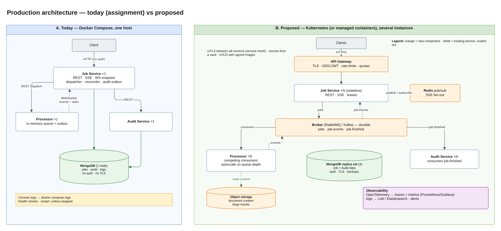

# Known Limitations & Production Improvements — TA9 Document Processing System

| | |
|---|---|
| **Assignment section** | README — *Known limitations and what you would improve for production* |
| **Scope** | Every known limitation of the submitted system, grouped by area, with its impact, what limits the impact today, and what a production version would do. A prioritized roadmap follows |
| **Sources** | Consolidates the limitation chapters of the topic documents (Concurrency, WebSocket, Storage, Logging), HLD §11 and the decision log (`docs/design/04-decisions.md`) |
| **Diagram** | draw.io page **12. Production Architecture** in `docs/hld/diagrams/ta9-hld.drawio` |

## 1. Context: what the submission is and is not

The system was built for a home assignment with an 8–10 hour time-box. The assignment explicitly excluded authentication, a UI, Kubernetes, message brokers and CI/CD. The design goal was therefore:

- **Correct and reliable at the required scale:** 10 concurrent jobs × 1,000 documents. Events are never lost or applied twice, and the system survives restarts and outages of any single component.
- **Honest about its limits:** every shortcut is deliberate, documented, and has a known upgrade path.
- **Built with seams for the next step:** storage behind interfaces, idempotent handlers, atomic leases, correlation ids and versioned event envelopes. Most production improvements below *replace a component*; they do not require a redesign.

Each limitation has an ID (area prefix + number) that the roadmap (§3) refers to.

## 2. Limitations by area

### 2.1 Scalability and performance (SC)

| ID | Limitation | Impact | Mitigation today | Production improvement |
|---|---|---|---|---|
| SC-1 | **One Job Service instance.** SSE fan-out and the WebSocket fan-in are per instance | A second instance would not see updates written by the first; clients connected to it would miss live status | Dispatch, leases and optimistic concurrency are already multi-instance safe; only the in-process fan-out is not | **Redis pub/sub** (or the broker) for job updates; several stateless instances behind a load balancer |
| SC-2 | **Processor state and queue are in memory** | A processor restart loses queued and running jobs | The reconciler finds lost jobs (processor returns 404) and redispatches them within ~1–2 min; analysis is deterministic, so redoing it is safe | **Durable broker** (RabbitMQ / Kafka) with competing processor consumers; it replaces REST dispatch, WebSocket events and most of the reconciler |
| SC-3 | **Fixed concurrency limits** (10 jobs × 2 documents) | The same limits apply on a 2-core and a 32-core host; may oversubscribe small hosts | Configurable (`Processing__*`); bounded, so overload becomes 503 + `Retry-After`, never a crash | Size from `ProcessorCount`; a global CPU limiter; **autoscaling** processors on queue depth |
| SC-4 | **Large inline payloads.** Documents travel inside the dispatch request; results travel inside `JobCompleted` (~0.5 MB per 1,000 documents) | High memory per job in the worst case (100 queued × 10 MB ≈ 1 GB); a replayed `JobCompleted` resends everything | Hard input limits (1,000 docs, 100 KB per doc, 10 MB per body, 16 MB per WS message) | **Object storage** for content (pass references); results written directly or pulled via REST; chunking for very large jobs |
| SC-5 | **Dispatch batches have head-of-line blocking** | One slow dispatch delays the next batch by up to the HTTP timeout | Small batches (4), short timeouts | Continuous semaphore-based pipeline, or the broker (SC-2) |
| SC-6 | **Skip/limit paging** | Deep pages get slower as collections grow | Fine at assignment scale; indexed sort | Keyset (cursor) paging |
| SC-7 | **Performance verified functionally, not benchmarked** | No automated latency or throughput thresholds; no soak test | E2E test asserts completion and the concurrency bound for 10 × 1,000; manual timed load script | Load tests in CI (k6 / NBomber) with SLOs; capacity model per instance |

### 2.2 Reliability (RE)

| ID | Limitation | Impact | Mitigation today | Production improvement |
|---|---|---|---|---|
| RE-1 | **Processor event outbox in memory** | Unacknowledged events are lost if the processor crashes | Reconciler recovers the final state from the Job Service side | Durable outbox (persisted) or the broker (SC-2) |
| RE-2 | **Bounded outboxes drop when full** | After ~10,000 unacked lifecycle events (a very long outage), new events are dropped | Logged as Errors; the reconciler recovers the jobs; capacity configurable | Broker with durable queues and back-pressure to producers |
| RE-3 | **Up to ~30 s extra latency after a lost ack** | A delivered event whose ack was lost is resent only on reconnect or after the ack timeout | Handling is idempotent, so the resend is harmless; timeout configurable | Broker acknowledgements remove the custom protocol |
| RE-4 | **No maximum job age** | During a very long processor outage, jobs stay `Queued` / `Processing` and are only rechecked | Reconciler retries and fails a job after 3 redispatches; dispatch fails after 5 unreachable attempts | A deadline per job (e.g. 1 h) with a clear failure reason; alerting |
| RE-5 | **No multi-document transactions** (D21) | A crash between writes can leave orphan documents | Write order makes it harmless: the job record is the commit marker; orphans are never referenced | Replica set + transactions, or a periodic orphan sweep |
| RE-6 | **A job deleted before its audit summary is published is never audited** | Gap in the audit trail for that job | Delete is allowed only for finished jobs; publishing is usually within seconds | Publish (or refuse delete) before deleting; or audit from the broker event (SC-2) |
| RE-7 | **Audit Service returns 500 (not 503) when its MongoDB is down** | Slightly less precise status code | The Job Service treats every 5xx as "unavailable" and retries; nothing is lost | Same `StorageUnavailableException` → 503 mapping as the Job Service |
| RE-8 | **No circuit breaker** | During an outage every call still waits for its timeout | Persisted exponential backoff with jitter keeps the call rate low | Circuit breaker on processor and audit clients (e.g. Polly) |

### 2.3 Storage (ST)

| ID | Limitation | Impact | Mitigation today | Production improvement |
|---|---|---|---|---|
| ST-1 | **Single MongoDB node, no authentication, no TLS, no backups** (Compose) | A disk or node failure loses data; anyone on the network can read it | Local Docker network only; named volume | **Replica set** (3 nodes), SCRAM/x.509 auth, TLS, encryption at rest, scheduled backups with restore tests |
| ST-2 | **Unbounded growth of jobs and documents** | Collections grow forever | Delete endpoint for finished jobs | Retention policy: TTL or archival of finished jobs and their content |
| ST-3 | **Logs share the MongoDB server with the data** | A database outage also loses log history for that time; log volume competes with the workload | Console keeps everything; log writes are batched and bounded | Dedicated log platform (see LG-1) |
| ST-4 | **Domain `Job` has public setters for the BSON mapper; contract DTOs stored as-is** (D2, D20) | The domain could be changed without its methods; a contract change affects stored data | State changes go through `Job` methods; DTOs are immutable records | Private setters with class-map mapping, or a separate persistence model, if the contracts diverge |

### 2.4 Observability (LG)

| ID | Limitation | Impact | Mitigation today | Production improvement |
|---|---|---|---|---|
| LG-1 | **No metrics and no distributed traces** | Queue depth, dispatch latency, outbox size and throughput cannot be charted or alerted on | Structured logs with `Service`, `CorrelationId`, `JobId`; health checks | **OpenTelemetry**: W3C trace context across HTTP/WS hops, metrics to Prometheus/Grafana, logs to Loki / Elasticsearch |
| LG-2 | **No alerting** | Failures are visible only when someone looks | `level: Error/Critical` are reserved for actionable failures; dropped-log records are reported | Alerts on error rate, failed jobs, readiness, queue depth, outbox size, `log events were not stored` |
| LG-3 | **Last ~1 s of Debug logs can be lost on a hard kill** | Missing tail in MongoDB after OOM / `docker kill` | Console is synchronous; the buffer is flushed on unhandled exceptions | Log shipping from stdout by the platform (the agent tails container logs) |
| LG-4 | **Log levels change only with a restart** | Debug cannot be turned on for a live incident without a restart | Debug is stored in MongoDB by default | Runtime level switch (Serilog `LoggingLevelSwitch` + admin endpoint), per-job sampling |

### 2.5 Security (SE)

| ID | Limitation | Impact | Mitigation today | Production improvement |
|---|---|---|---|---|
| SE-1 | **No authentication or authorization** (out of scope by assignment) | Anyone who reaches the API can create, read, cancel and delete any job | Local deployment only | **API gateway** with OAuth2/OIDC (JWT); per-tenant authorization on every job |
| SE-2 | **Unauthenticated service-to-service traffic** (REST dispatch, WebSocket events, audit) | A rogue client on the network could send forged events | Internal Docker network; correlation ids validated | **mTLS** between services (service mesh) or signed service tokens on connect |
| SE-3 | **No rate limiting or quotas** | One client can fill the queue for everyone | Bounded queue + 503 protects the services, not fairness between clients | Rate limiting at the gateway and per-tenant quotas |
| SE-4 | **Swagger enabled in every environment; health endpoints public** | API surface and internals exposed | POC convenience | Swagger only in Development; health endpoints on an internal port |
| SE-5 | **HTTP only, no TLS** | Traffic readable on the network | Local only | TLS at the gateway and between services (SE-2) |
| SE-6 | **No secret management** | — (there are no secrets: Mongo has no auth) | Nothing secret is committed | Secrets from a vault / Kubernetes secrets once ST-1 adds credentials |

Input-side protections already in place: size limits on requests, documents and WS messages; validation of every input; sanitized correlation ids (no log injection); document contents never logged; non-root containers.

### 2.6 API and functionality (API)

| ID | Limitation | Impact | Mitigation today | Production improvement |
|---|---|---|---|---|
| API-1 | **`POST /api/jobs` has no idempotency key** | A client that retries after a timeout creates a duplicate job | The response carries the job id; clients can check before retrying | `Idempotency-Key` header stored with the job |
| API-2 | **No API versioning** | A breaking change would affect all clients at once | Additive changes only; WS envelope already has `schemaVersion` | URL or header versioning (`/api/v1`), deprecation policy |
| API-3 | **Documents only inline as text** | No file upload, no binary formats, 100 KB per document | Clear 400 validation errors | Upload to object storage (pre-signed URLs), content-type handling |
| API-4 | **Completion only by polling or SSE** | No push to the client's own systems | SSE stream per job | Webhooks / callbacks with retries and signatures |
| API-5 | **Results are kept until the job is deleted** | Storage grows; old results remain readable forever | Delete endpoint | Retention (ST-2), result expiry policy |

### 2.7 Operations and delivery (OP)

| ID | Limitation | Impact | Mitigation today | Production improvement |
|---|---|---|---|---|
| OP-1 | **Docker Compose on one host** | No high availability, no rolling updates, no autoscaling | Health checks and `restart: unless-stopped` | Kubernetes (or a managed container service): replicas, probes, HPA on queue depth, rolling deploys |
| OP-2 | **No CI/CD pipeline** (out of scope) | Builds and tests run by hand | One command each: `dotnet test Ta9.sln`, `docker compose up --build` | Pipeline: build, unit + integration tests (Testcontainers), image scan, SBOM, signed images, deploy per environment |
| OP-3 | **Prebuilt-image path for TLS-inspecting networks** | Two ways to build images | The standard multi-stage `Dockerfile` remains the intended one | Build in CI, where network policy is controlled |
| OP-4 | **E2E tests run in one process** | Real network faults between containers are tested only manually (MT-07 to MT-09) | TestServer with a real WebSocket and real MongoDB; manual Docker procedures | Container-level chaos tests (kill / partition) in CI |
| OP-5 | **Configuration through environment variables only** | No central configuration or feature flags | `appsettings.json` defaults + env overrides, validated at startup | Config service / Kubernetes ConfigMaps, feature flags |

## 3. Production roadmap

### P1 — before any production traffic
| Step | Addresses | Notes |
|---|---|---|
| Authentication at an API gateway (OIDC/JWT), per-tenant authorization | SE-1, SE-4, SE-5 | Gateway also terminates TLS |
| mTLS between services | SE-2, SE-5 | Service mesh or certificates per service |
| MongoDB replica set with auth, TLS, encryption at rest, backups | ST-1, RE-5 | Also enables transactions |
| Rate limiting and per-tenant quotas | SE-3 | At the gateway |
| `Idempotency-Key` on job creation | API-1 | Small change in `JobManager` |
| CI/CD with tests, image scanning and signed images | OP-2, OP-3 | Integration tests already use Testcontainers |
| Metrics, traces and alerting (OpenTelemetry) | LG-1, LG-2 | The correlation id maps onto W3C trace context |

### P2 — scale and resilience
| Step | Addresses | Notes |
|---|---|---|
| Durable broker (RabbitMQ / Kafka): job queue, job events, audit events | SC-2, RE-1, RE-2, RE-3, RE-6, SC-5 | Handlers are already idempotent and events are already versioned; the reconciler stays as a safety net |
| Several Job Service instances + Redis pub/sub for SSE | SC-1 | Dispatch is already lease-based and multi-instance safe |
| Kubernetes with autoscaling processors on queue depth | OP-1, SC-3 | Probes already exist (`/health/live`, `/health/ready`) |
| Object storage for document content and large results | SC-4, API-3 | Messages carry references |
| Dedicated log platform; the MongoDB log sink becomes optional | ST-3, LG-3 | Console JSON is already structured |
| Retention policies for jobs, documents and results | ST-2, API-5 | TTL or archival |

### P3 — refinements
Keyset paging (SC-6) · circuit breakers (RE-8) · maximum job age (RE-4) · runtime log levels (LG-4) · API versioning (API-2) · webhooks (API-4) · load and chaos tests in CI (SC-7, OP-4) · 503 mapping in the Audit Service (RE-7) · private setters / persistence model (ST-4) · central configuration (OP-5).

## 4. Why the current design makes these steps cheap

| Existing seam | Production step it enables |
|---|---|
| Storage behind interfaces + a contract test suite run against every store | Replica set, another database, or object storage for content, without touching business code |
| Idempotent event handling, a state machine that ignores duplicates and late events, versioned event envelopes | Moving events to a broker with at-least-once delivery |
| Retry state persisted in the job, atomic claims with leases | Several Job Service instances dispatching safely |
| Correlation id stored with the job and propagated over HTTP and WebSocket | OpenTelemetry tracing (W3C trace context) |
| Bounded queues with 503 + `Retry-After` end to end | Autoscaling on queue depth; graceful overload |
| Health checks (live / ready, Degraded for the WS link) | Kubernetes probes |
| Configuration validated at startup, environment overrides | ConfigMaps / secrets without code changes |

## 5. Tests for this section

The complete catalog of the system's tests, with strategy, environment, traceability and results, is the **Software Test Description (STD)** — `docs/testing/TA9-STD.docx` (Markdown: `docs/testing/STD.md`). This chapter lists only the tests that verify **the current limits and the mitigations described in this document**. The **STD ID** column is the identifier of the same test case in the STD, so each test can be looked up there; *Theory ×N* runs N data rows, *×2 stores* runs against InMemory and MongoDB.
A limitation cannot be "tested away"; these tests pin **the documented behavior at each limit**, so that the mitigations in §2 are real and stay real.

### 5.1 What is verified

| Limitation (§2) | Documented mitigation | Verified by |
|---|---|---|
| SC-3 fixed limits | Overload becomes 503 + `Retry-After`, honored without counting a failure | `ProcessApiTests`, `ChannelJobQueueTests`, `JobDispatcherTests` |
| SC-1 single instance | Dispatch and updates are already multi-instance safe | `JobRepositoryContract` (concurrent claims and updates, InMemory + MongoDB) |
| SC-2 / RE-1 in-memory processor state and outbox | The reconciler recovers lost jobs and lost events; repeated loss fails the job | `JobReconcilerTests`, E2E processor restart |
| RE-2 bounded outbox | Full outbox rejects and logs, never throws | `EventOutboxTests`, `WebSocketJobEventPublisherTests` |
| RE-3 resends / duplicates; API-2 versioning | Duplicates and newer schema versions are ignored safely | `ProcessorEventHandlerTests` |
| SC-4 large payloads | Hard input limits are enforced | `CreateJobRequestValidatorTests`, `JobsApiTests` |
| ST-3 / LG-3 logging limits | A full log buffer drops and reports, never blocks | `BatchingLogSinkTests` |
| ST-1 storage outage | 503 *Storage unavailable* | `JobsApiStorageFailureTests` |
| The required scale works within the limits | 10 × 1,000 documents with bounded parallelism | E2E |

### 5.2 Automated tests

| STD ID | Test case | Test class | Level | Kind |
|---|---|---|---|---|
| PS-099 | Post returns 503 with retry after when queue is full | `ProcessApiTests` | Component | Fact |
| PS-066 | Rejects when capacity is reached | `ChannelJobQueueTests` | Unit | Fact |
| JS-056 | Busy processor delays the job without consuming an attempt | `JobDispatcherTests` | Unit | Fact |
| JS-057 | Unreachable processor backs off then fails the job | `JobDispatcherTests` | Unit | Fact |
| JS-060 | A crashed dispatch is retried after the lease expires | `JobDispatcherTests` | Unit | Fact |
| JS-042 | Concurrent claims never hand out the same job twice | `JobRepositoryContract` | Contract (InMemory + MongoDB) | Fact · ×2 stores |
| JS-037 | Concurrent updates never lose a write | `JobRepositoryContract` | Contract (InMemory + MongoDB) | Fact · ×2 stores |
| JS-076 | Job lost by a restarted processor is redispatched | `JobReconcilerTests` | Unit | Fact |
| JS-077 | Job lost too many times fails | `JobReconcilerTests` | Unit | Fact |
| JS-074 | Lost completion event is recovered with results | `JobReconcilerTests` | Unit | Fact |
| PS-078 | Rejects lifecycle events beyond capacity | `EventOutboxTests` | Unit | Fact |
| PS-077 | Full outbox does not throw | `WebSocketJobEventPublisherTests` | Unit | Fact |
| JS-099 | Replayed completion is ignored | `ProcessorEventHandlerTests` | Unit | Fact |
| JS-105 | Newer schema version is ignored | `ProcessorEventHandlerTests` | Unit | Fact |
| JS-110 | Rejects too many documents with a single error | `CreateJobRequestValidatorTests` | Unit | Fact |
| JS-125 | Create with oversized document is rejected | `JobsApiTests` | Component | Fact |
| SD-017 | Full buffer drops events without blocking and reports the count | `BatchingLogSinkTests` | Unit | Fact |
| JS-136 | Storage timeout returns 503 problem | `JobsApiStorageFailureTests` | Component | Fact |
| E2E-004 | Job lost by a processor restart is redispatched and completes | `EndToEndTests` | Integration (E2E) | Fact |
| E2E-002 | Ten concurrent jobs of 1000 documents complete with bounded parallelism | `EndToEndTests` | Integration (E2E) | Fact |

All tests listed here passed in the latest full run (440 / 440, 2026-10-27).

