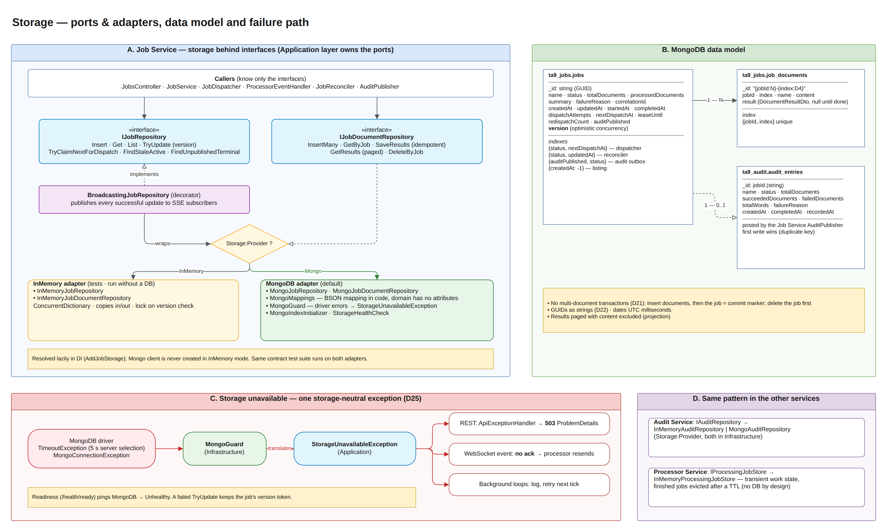

# Storage — TA9 Document Processing System

| | |
|---|---|
| **Assignment section** | §6 Storage |
| **Requirement** | In-memory storage is acceptable. Structure the implementation so that **replacing it with persistent storage would be reasonably straightforward**. A database is not required |
| **Chosen strategy** | **Ports & adapters**: every service talks to storage only through interfaces owned by its Application layer. Each interface has **two implementations, InMemory and MongoDB**, chosen by one configuration key (`Storage:Provider`). The Docker deployment runs on MongoDB; tests run the **same contract suite** against both |
| **Diagram** | draw.io page **10. Storage** in `docs/hld/diagrams/ta9-hld.drawio` |

## 1. The requirement and how we read it

The assignment accepts in-memory storage and asks only that a persistent store be easy to plug in later. We went one step further: the persistent store is **already plugged in** (MongoDB, in Docker Compose), and the in-memory store is kept as a first-class alternative. That turns "replacing it would be straightforward" from a promise into something the code and the tests show:

- the business code never references a database type;
- two very different stores (a dictionary in RAM and a document database over the network) satisfy the same interface;
- one automated test suite checks that they behave identically.

## 2. What we built



### 2.1 Storage interfaces (ports)

| Service | Interface | Responsibility | Implementations |
|---|---|---|---|
| Job Service | `IJobRepository` | Jobs: insert, get, list (paged, filtered), **`TryUpdate` with optimistic concurrency** (`version`), **atomic claim with lease** for the dispatcher, queries for the reconciler and the audit outbox | `InMemoryJobRepository`, `MongoJobRepository` |
| Job Service | `IJobDocumentRepository` | Documents of a job and their results: bulk insert, read in order, **idempotent** result save, paged results, delete | `InMemoryJobDocumentRepository`, `MongoJobDocumentRepository` |
| Audit Service | `IAuditRepository` | Audit entries: insert-if-absent (**first write wins**), get by job id | `InMemoryAuditRepository`, `MongoAuditRepository` |
| Processor Service | `IProcessingJobStore` | Transient work state of jobs in this instance; finished jobs evicted after `ResultsTtl` (1 h) | `InMemoryProcessingJobStore` (by design, see §3.3) |

The interfaces live in each service's **Application** layer, and every implementation lives in **Infrastructure**. The domain classes (`Job`, `JobDocument`, `AuditEntry`) have no persistence attributes: the BSON mapping is written in code (`MongoMappings`, `AuditMongoMappings`).

The interfaces express **behavior**, not CRUD: "save only if nobody changed it" (`TryUpdateAsync`) and "give me one due job that no one else is holding" (`TryClaimNextForDispatchAsync`). Concurrency guarantees are therefore part of the contract every store must keep, not something the callers hope for.

### 2.2 Choosing the store: one configuration key

```json
"Storage": {
  "Provider": "Mongo",                       // or "InMemory"
  "Mongo": { "ConnectionString": "mongodb://mongo:27017", "Database": "ta9_jobs" }
}
```

`AddJobStorage` (and the Audit equivalent) registers both implementations and picks one **when the repository is first resolved**, so in InMemory mode no Mongo client is ever created and no database is needed. Docker Compose sets `Storage__Provider: Mongo`. Running a service from the IDE with `Storage__Provider=InMemory` needs nothing but .NET.

A decorator, `BroadcastingJobRepository`, wraps whichever job store was chosen and publishes every successful update to live (SSE) subscribers. The feature works the same on both stores and neither store knows about it.

### 2.3 MongoDB data model

| Collection | Key | Contents | Indexes |
|---|---|---|---|
| `ta9_jobs.jobs` | `_id` = job id (GUID as string) | Status, counters, summary, timestamps, dispatch state (`dispatchAttempts`, `nextDispatchAt`, `leaseUntil`), `auditPublished`, `version` | `{status, nextDispatchAt}` dispatcher · `{status, updatedAt}` reconciler · `{auditPublished, status}` audit outbox · `{createdAt: -1}` listing |
| `ta9_jobs.job_documents` | `_id` = `"{jobId:N}-{index:D4}"` | Name, content, result (null until processed) | `{jobId, index}` unique |
| `ta9_audit.audit_entries` | `_id` = job id | Final summary of a job | `_id` only (makes "first write wins" atomic) |

Design points:

- **Documents are separate from the job.** A job of 1,000 documents can carry megabytes of content. Keeping it in its own collection keeps the job record small; status polls and progress updates never move the content. Result pages project the content out.
- **Deterministic document ids** make saving results idempotent: a replayed `JobCompleted` event updates the same rows.
- **No multi-document transactions** (D21; they need a replica set). Write order replaces them: documents first, then the job (the job record is the commit marker); on delete, the job first, then its documents. A crash in between leaves only orphan documents that nothing references.
- **GUIDs are stored as strings** (D22) after a real defect (STD **D-01**): the driver's legacy GUID mode made id queries return nothing.
- **Indexes are created at startup** (`MongoIndexInitializer`). If that fails, the error is logged and readiness reports the database state; the service does not crash.

### 2.4 Concurrency control in storage

| Mechanism | InMemory | MongoDB |
|---|---|---|
| Optimistic concurrency (`TryUpdate`) | Version compared under a lock, then the stored copy is replaced | `ReplaceOne` filtered by `{_id, version}`; `MatchedCount == 0` → conflict |
| Atomic dispatch claim with lease | Lock + scan for the longest-waiting due job | One `findOneAndUpdate` (filter: Pending, due, no live lease; sort `nextDispatchAt`) |
| First write wins (audit) | `ConcurrentDictionary.TryAdd` | Insert; duplicate-key error → "already existed" |
| Isolation of loaded objects | Copies in and out (`Clone`) | Natural (deserialized copies) |

`JobRepositoryExtensions.UpdateAsync` wraps load → mutate → `TryUpdate` with retries on conflict. Callers write the business rule once and it is correct on any store. Details are in the Concurrency & Performance document.

### 2.5 When the database is down

The Mongo repositories run every operation through `MongoGuard`, which translates the driver's "unreachable" errors (`TimeoutException` from server selection, `MongoConnectionException`) into **`StorageUnavailableException`**, an exception type defined in the Application layer (D25). Above the repositories nothing references the driver:

| Where | Behavior |
|---|---|
| REST API | `ApiExceptionHandler` → **503** ProblemDetails *Storage unavailable* (retryable) |
| WebSocket events | Event is **not acknowledged**, so the processor resends it later |
| Background loops (dispatcher, reconciler, audit publisher) | Log and retry on the next tick |
| Readiness `/health/ready` | Pings the database → **Unhealthy** |

The client fails fast: 5 s server selection instead of the driver's 30 s default. A failed `TryUpdate` also restores the job's `version` field, so the caller's object stays consistent.

## 3. Why this approach

### 3.1 Why interfaces + two implementations

| Advantage | Explanation |
|---|---|
| **Replacement is proven, not promised** | Two stores with nothing in common already satisfy the interfaces |
| **Behavioral contract tests** | `JobRepositoryContract`, `JobDocumentRepositoryContract` and `AuditRepositoryContract` are abstract test classes; each store is a subclass. A new store (e.g. PostgreSQL) gets the full suite, including the concurrency tests, by adding one test class |
| **Fast tests and simple local runs** | Component and API tests use InMemory (no Docker, milliseconds); Mongo tests run under `Category=Integration` with Testcontainers |
| **Business code stays clean** | No driver types, attributes or connection handling in domain/application code |
| **Configuration-only switch** | Changing the store means changing one setting, not the code |

### 3.2 Why MongoDB for the persistent store

- The data is **document-shaped**: a job with an embedded summary, and documents with an embedded result. No joins are needed.
- Its atomic single-document operations (`findOneAndUpdate`, conditional `replaceOne`, unique `_id`) are exactly what optimistic concurrency, leases and first-write-wins need, without transactions.
- It runs as a single container with no schema migrations, which fits the time-box and Docker Compose.
- Data survives service restarts, which the reliability features depend on: retry state, the audit outbox flag and the reconciler.

### 3.3 Why the Processor stays in memory

The Processor holds **transient work state**. The Job Service is the system of record. If a Processor restarts, the Job Service reconciler notices the job is unknown and dispatches it again (STD E2E test *Job lost by a processor restart is redispatched and completes*). Persisting it would add a database dependency to a stateless worker without improving correctness. `IProcessingJobStore` keeps the option open.

### 3.4 Alternatives considered

| Alternative | Why not chosen |
|---|---|
| In-memory only (the minimum the assignment asks for) | Loses all jobs on restart, so retries, the outbox and the reconciler could not be demonstrated across restarts |
| Relational DB (PostgreSQL) + EF Core | Equally valid. It needs a schema and migrations, and the document-shaped data maps less directly. The interfaces allow it later (§5) |
| Generic `IRepository<T>` | Cannot express claim-with-lease or conditional update; callers would rebuild concurrency on top, differently per store |
| EF Core-style unit of work with change tracking | Hides when writes happen; we want explicit, versioned writes |

## 4. Limitations and trade-offs

| Limitation | Impact | Mitigation / note |
|---|---|---|
| `Job` has public setters, used by the BSON mapper (D2) | The domain could be changed without its methods | State changes go through `Job` methods; setters only used by the mapper and `Clone` |
| Contract DTOs stored in persistence (D20) | A contract change affects stored data | Immutable value records shared by both services; mapping layer if they ever diverge |
| No transactions (D21) | A crash can leave orphan documents | Harmless (unreferenced); a sweep job could remove them |
| InMemory data is per process | Lost on restart; not shared between instances | Intended only for tests / local runs; Docker uses MongoDB |
| Audit Service has no 503 mapping | If its MongoDB is down, `POST /api/audit` returns 500 | The Job Service treats any 5xx as "unavailable" and keeps the job in its outbox, so nothing is lost |
| Single MongoDB node, no auth, no backup in Compose | Not production-grade | See §6 |
| Paging uses skip/limit | Slow for very deep pages | Fine at assignment scale; keyset paging later |

## 5. How to replace the storage (e.g. PostgreSQL)

1. Add `PostgresJobRepository : IJobRepository` and `PostgresJobDocumentRepository : IJobDocumentRepository` under `Infrastructure/Storage/Postgres`.
   - `TryUpdateAsync` → `UPDATE jobs SET … , version = version + 1 WHERE id = @id AND version = @expected`; 0 rows → `false`.
   - `TryClaimNextForDispatchAsync` → `UPDATE … WHERE id = (SELECT id FROM jobs WHERE status = 'Pending' AND next_dispatch_at <= @now AND (lease_until IS NULL OR lease_until <= @now) ORDER BY next_dispatch_at LIMIT 1 FOR UPDATE SKIP LOCKED) RETURNING *`.
   - Translate connection failures to `StorageUnavailableException` (like `MongoGuard`).
2. Add `Postgres` to `StorageProvider` and one branch in `AddJobStorage`.
3. Add `PostgresJobRepositoryTests : JobRepositoryContract` (Testcontainers.PostgreSql). Once it is green, the new store keeps every guarantee the old one did, concurrency included.

No change is needed in the domain, the API, the dispatcher, the event handler, the reconciler or the audit publisher.

## 6. Possible improvements for production

- MongoDB replica set (high availability; also enables transactions), authentication and TLS, backups.
- TTL index or archival for finished jobs and their documents.
- Store large document content in object storage (S3 / Blob) with only a reference in the database.
- Keyset (cursor) paging for listing and results.
- 503 mapping in the Audit Service as well.

## 7. Tests for this section

The complete catalog of the system's tests, with strategy, environment, traceability and results, is the **Software Test Description (STD)** — `docs/testing/TA9-STD.docx` (Markdown: `docs/testing/STD.md`). This chapter lists only the tests that verify **§6 Storage**. The **STD ID** column is the identifier of the same test case in the STD, so each test can be looked up there; *Theory ×N* runs N data rows, *×2 stores* runs against InMemory and MongoDB.

### 7.1 What is verified

| Claim in this document | Verified by |
|---|---|
| InMemory and MongoDB stores behave identically (same suite, ×2 stores) | `JobRepositoryContract`, `JobDocumentRepositoryContract`, `AuditRepositoryContract` |
| Optimistic concurrency, atomic claim with lease, first write wins — on both stores | Concurrency cases of the contract suites |
| Callers are store-agnostic: load → mutate → save with retries | `JobRepositoryExtensionsTests` |
| A decorator adds behavior to any store | `BroadcastingJobRepositoryTests` |
| Processor work state is bounded in time (TTL eviction) | `InMemoryProcessingJobStoreTests` |
| Driver errors become `StorageUnavailableException`; version token kept on failure | `MongoUnavailableTests` (no Docker needed) |
| Storage outage → 503 on REST, no ack on WebSocket, readiness reflects storage | `JobsApiStorageFailureTests`, `ProcessorEventsEndpointTests`, `ProcessorEventHandlerTests`, `JobsApiTests`, `AuditApiTests` |
| Mongo GUID encoding defect stays fixed | Contract suites on MongoDB (STD defect **D-01**) |

### 7.2 Automated tests

| STD ID | Test case | Test class | Level | Kind |
|---|---|---|---|---|
| JS-032 | Insert then get round trips every field | `JobRepositoryContract` | Contract (InMemory + MongoDB) | Fact · ×2 stores |
| JS-033 | Get unknown job returns null | `JobRepositoryContract` | Contract (InMemory + MongoDB) | Fact · ×2 stores |
| JS-034 | Update persists changes and increments version | `JobRepositoryContract` | Contract (InMemory + MongoDB) | Fact · ×2 stores |
| JS-035 | Update with a stale version is rejected | `JobRepositoryContract` | Contract (InMemory + MongoDB) | Fact · ×2 stores |
| JS-036 | Changes to a loaded job are not visible until saved | `JobRepositoryContract` | Contract (InMemory + MongoDB) | Fact · ×2 stores |
| JS-037 | Concurrent updates never lose a write | `JobRepositoryContract` | Contract (InMemory + MongoDB) | Fact · ×2 stores |
| JS-038 | List filters orders newest first and pages | `JobRepositoryContract` | Contract (InMemory + MongoDB) | Fact · ×2 stores |
| JS-039 | Claim leases the due pending job until the lease expires | `JobRepositoryContract` | Contract (InMemory + MongoDB) | Fact · ×2 stores |
| JS-040 | Claim skips jobs that are not due or not pending | `JobRepositoryContract` | Contract (InMemory + MongoDB) | Fact · ×2 stores |
| JS-041 | Claim takes the longest waiting job first | `JobRepositoryContract` | Contract (InMemory + MongoDB) | Fact · ×2 stores |
| JS-042 | Concurrent claims never hand out the same job twice | `JobRepositoryContract` | Contract (InMemory + MongoDB) | Fact · ×2 stores |
| JS-043 | Stale query returns only silent active jobs oldest first | `JobRepositoryContract` | Contract (InMemory + MongoDB) | Fact · ×2 stores |
| JS-044 | Unpublished query returns finished jobs not yet audited | `JobRepositoryContract` | Contract (InMemory + MongoDB) | Fact · ×2 stores |
| JS-045 | Delete removes the job once | `JobRepositoryContract` | Contract (InMemory + MongoDB) | Fact · ×2 stores |
| JS-027 | Returns documents of one job ordered by index | `JobDocumentRepositoryContract` | Contract (InMemory + MongoDB) | Fact · ×2 stores |
| JS-028 | Saving results is idempotent | `JobDocumentRepositoryContract` | Contract (InMemory + MongoDB) | Fact · ×2 stores |
| JS-029 | Results are paged by index | `JobDocumentRepositoryContract` | Contract (InMemory + MongoDB) | Fact · ×2 stores |
| JS-030 | Results for unknown documents are ignored | `JobDocumentRepositoryContract` | Contract (InMemory + MongoDB) | Fact · ×2 stores |
| JS-031 | Delete removes only the given job | `JobDocumentRepositoryContract` | Contract (InMemory + MongoDB) | Fact · ×2 stores |
| AS-010 | First write wins | `AuditRepositoryContract` | Contract (InMemory + MongoDB) | Fact · ×2 stores |
| AS-011 | Unknown job returns null | `AuditRepositoryContract` | Contract (InMemory + MongoDB) | Fact · ×2 stores |
| JS-081 | Applies the mutation and saves | `JobRepositoryExtensionsTests` | Unit | Fact |
| JS-082 | Reports not found | `JobRepositoryExtensionsTests` | Unit | Fact |
| JS-083 | Does not write when the mutation declines | `JobRepositoryExtensionsTests` | Unit | Fact |
| JS-084 | Reloads and retries on conflict | `JobRepositoryExtensionsTests` | Unit | Fact |
| JS-085 | Gives up after max attempts | `JobRepositoryExtensionsTests` | Unit | Fact |
| JS-092 | Successful update is published with the new version | `BroadcastingJobRepositoryTests` | Unit | Fact |
| JS-093 | Rejected update is not published | `BroadcastingJobRepositoryTests` | Unit | Fact |
| JS-094 | Dispatch claims are not published | `BroadcastingJobRepositoryTests` | Unit | Fact |
| PS-068 | Rejects duplicate job id | `InMemoryProcessingJobStoreTests` | Unit | Fact |
| PS-069 | Removes only finished jobs older than cutoff | `InMemoryProcessingJobStoreTests` | Unit | Fact |
| JS-143 | Job repository reads and writes report storage unavailable | `MongoUnavailableTests` | Unit | Fact |
| JS-144 | Failed update keeps the version token unchanged | `MongoUnavailableTests` | Unit | Fact |
| JS-145 | Document repository reports storage unavailable | `MongoUnavailableTests` | Unit | Fact |
| JS-136 | Storage timeout returns 503 problem | `JobsApiStorageFailureTests` | Component | Fact |
| JS-142 | Event that cannot be stored is not acknowledged | `ProcessorEventsEndpointTests` | Component | Fact |
| JS-107 | Storage failure propagates so the event is not acknowledged | `ProcessorEventHandlerTests` | Unit | Fact |
| JS-135 | Readiness reports storage health | `JobsApiTests` | Component | Fact |
| AS-005 | Readiness reports storage | `AuditApiTests` | Component | Fact |

Contract suites against MongoDB need Docker (`Category=Integration`, Testcontainers). All tests listed here passed in the latest full run (440 / 440, 2026-10-27).

### 7.3 Manual tests

| STD ID | Procedure | Expected result | Status |
|---|---|---|---|
| MT-01 | `docker compose up -d`; open `/health/ready` on :5001 and :5003 | `Healthy` — MongoDB reachable | Passed (2026-10-26) |
| MT-09 | `docker compose stop mongo`; `GET /api/jobs` and `/health/ready` on :5001; `docker compose start mongo` | 503 *Storage unavailable* within ~5 s; readiness Unhealthy; recovers after Mongo starts | Not yet executed |

