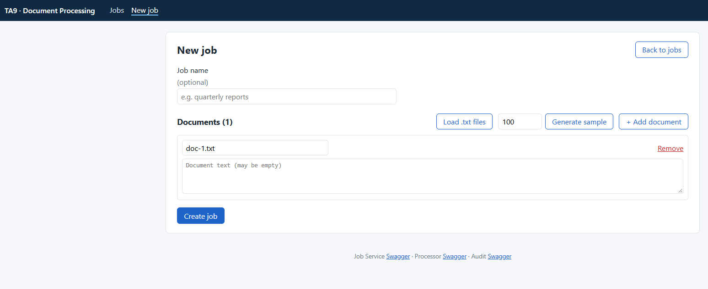
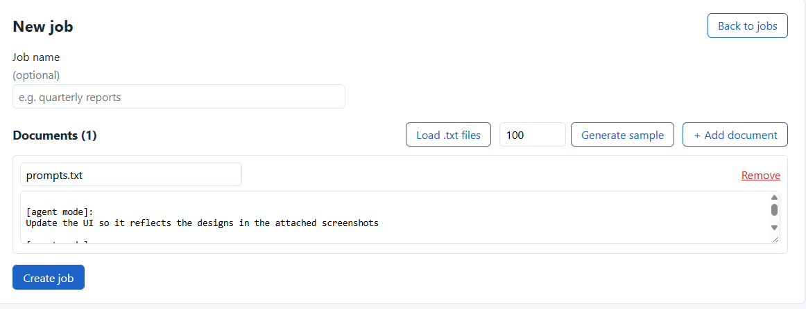
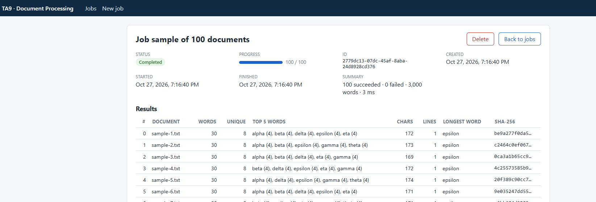
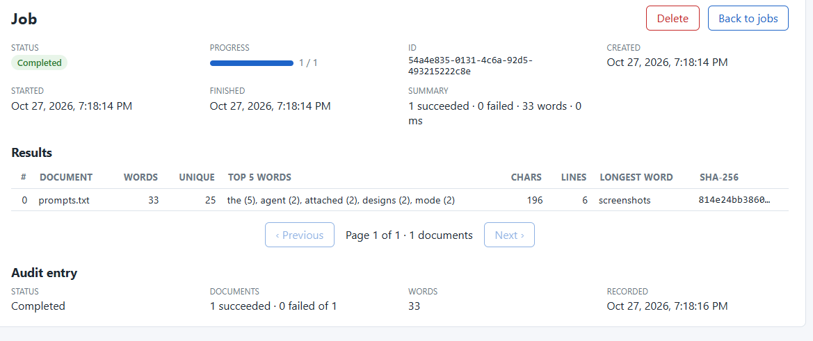
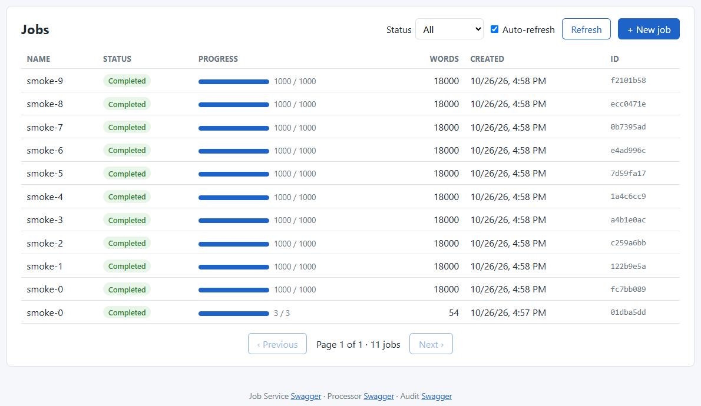
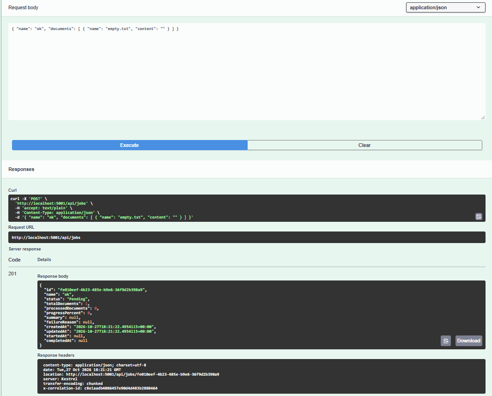
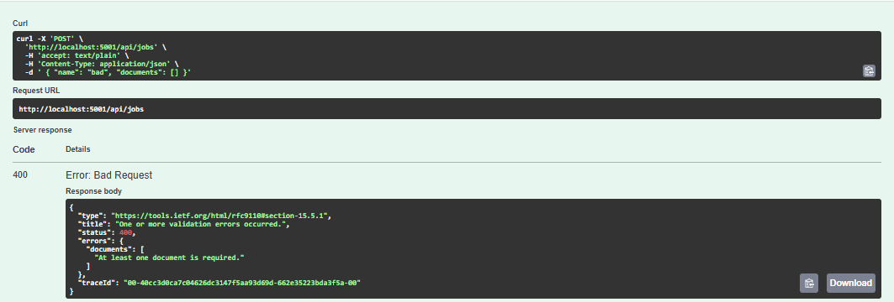
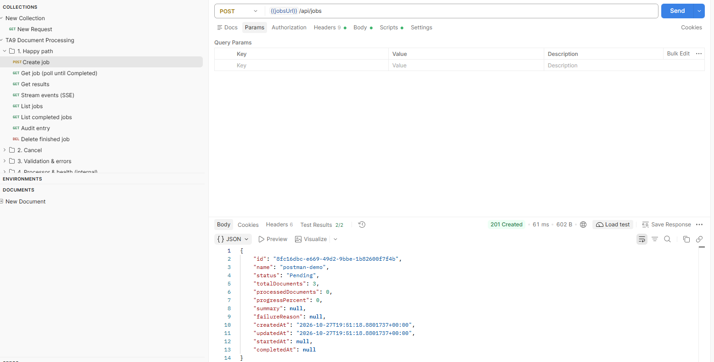
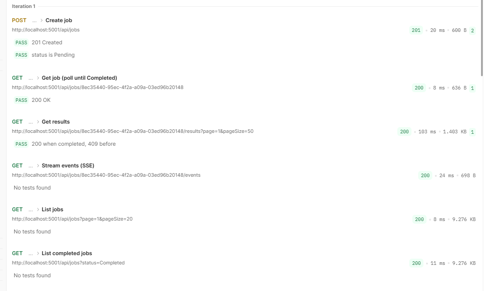

# User Guide — TA9 Document Processing System

| | |
|---|---|
| **Audience** | Anyone who wants to *use* the system: submit documents, follow their processing and read the results. No knowledge of the code is needed |
| **Before you start** | The system must be running. Installing and starting it is described in the **Installation Guide** (`docs/installation/TA9-Installation-Guide.docx`). The short version is `docker compose up --build -d` |
| **Three ways to work** | **Web UI** (browser, no tools) · **Swagger** (browser, every API call) · **Postman** (ready-made scenarios with built-in checks) |

## 1. What the system does

You send a **job**: a batch of up to **1,000 text documents**. The system analyzes every document in the background and keeps you informed while it works. When it finishes, you get these results for each document:

| Result | Example |
|---|---|
| Word count · unique word count | 30 · 8 |
| Five most frequent words | `alpha (4), beta (4), delta (4), epsilon (4), eta (4)` |
| SHA-256 of the text | `be9a277f0da5…` |
| Characters · lines · average word length · longest word | 172 · 1 · 4.8 · `epsilon` |

When a job ends, a short summary of it is also stored by the **Audit Service**.

### 1.1 The life of a job

| Status | Meaning |
|---|---|
| **Pending** | Accepted and stored; waiting to be handed to the processor |
| **Queued** | The processor has accepted it; waiting for a free worker |
| **Processing** | Documents are being analyzed; progress (`processed / total`) moves |
| **Completed** | Done. Results are available. If some documents failed, they are marked individually; the job still completes |
| **Failed** | The job could not be processed (for example every document failed, or the processor was unreachable for too long). The failure reason is shown |
| **Cancelled** | You cancelled it before it finished |

A job normally goes `Pending → Queued → Processing → Completed`, often within a second. Ten jobs of 1,000 documents each take a few seconds.

### 1.2 Limits

| Limit | Value | If exceeded |
|---|---|---|
| Documents per job | 1 – 1,000 | `400 Bad Request` with the reason |
| Size of one document | 100 KB (UTF-8) | `400` |
| Document name | required, up to 256 characters | `400` |
| Job name | optional, up to 200 characters | `400` |
| Request size | ~10 MB | `413` / `400` |

An **empty document is allowed**: it simply has 0 words.

## 2. Choose how to work

| | **Web UI** | **Swagger** | **Postman** |
|---|---|---|---|
| Best for | Trying the system, demos, following a job live | Exploring every endpoint and its exact request / response | Running prepared scenarios repeatedly, with automatic checks |
| Address | http://localhost:4200 | http://localhost:5001/swagger (jobs) · :5003/swagger (audit) · :5002/swagger (processor, internal) | The collection `docs/postman/Ta9.postman_collection.json` |
| Install anything? | No, just a browser | No, just a browser | Yes: the Postman app (§5.1) |
| Live progress | Yes, automatic | No (call `GET` again) | No (send again) |
| Covers | Create, list, details, results, cancel, delete, audit | Everything, including internal and health endpoints | Happy path, cancel, validation errors, internal and health |

All three use **the same API**, so you can mix them. For example, create a job in Postman and watch it in the Web UI.

## 3. Working with the Web UI

Open **http://localhost:4200**. The top bar has two pages: **Jobs** and **New job**. Links to the three Swagger pages are at the bottom.

### 3.1 Create a job

Click **New job** (or **+ New job** on the jobs page).



1. **Job name** *(optional)*: e.g. `quarterly reports`.
2. Add the documents in one of three ways:
   - **Type them in.** Each document has a name and a text box. **+ Add document** adds another one; **Remove** deletes one.
   - **Load .txt files.** Pick one or more text files from your computer. Each file becomes a document with the file's name.
   - **Generate sample.** Enter a number (up to 1,000) and click **Generate sample**. The page creates that many sample documents. This is the quickest way to see the system handle a large job.
3. Click **Create job**. The details page of the new job opens at once.

Example with one typed document:



If something is wrong, for example no documents or a document over 100 KB, a hint appears and **Create job** stays disabled. If the server rejects the job, its message is shown in red, including which field is wrong.

### 3.2 Follow a job and read the results

The details page shows the status, the progress bar, the times and a summary. While the job runs, a green **● live** marker shows that the page updates by itself. You don't need to refresh.

When the job is **Completed**, the **Results** table lists every document: words, unique words, top five words, characters, lines, longest word and SHA-256. Hover over the shortened hash to see it in full. Large jobs are paged (50 documents per page).



A few seconds after the job ends, the **Audit entry** appears at the bottom of the page. It is the summary that the Audit Service stored:



| Button | When it is shown | What it does |
|---|---|---|
| **Cancel job** | While the job is Pending, Queued or Processing | Stops the job; its status becomes **Cancelled** |
| **Delete** | When the job has ended | Asks for confirmation, then deletes the job and its results |
| **Back to jobs** | Always | Returns to the list |

### 3.3 The jobs list

The **Jobs** page lists all jobs, newest first, with status, progress, total words, creation time and the start of the id. Click a row to open its details.



- **Status** filters the list (e.g. only *Completed* or only *Failed*).
- **Auto-refresh** reloads the list every 3 seconds; **Refresh** reloads it once.
- **Previous / Next** page through the list (20 jobs per page).

## 4. Working with Swagger

Swagger is an interactive page, built into each service, that lists every API call and lets you send it from the browser.

| Service | Swagger | Use it for |
|---|---|---|
| **Job Service** | http://localhost:5001/swagger | Everything a user does: create, list, get, results, live status, cancel, delete |
| **Audit Service** | http://localhost:5003/swagger | Reading the audit entry of a finished job |
| Processor Service | http://localhost:5002/swagger | *Internal*: the Job Service calls it. Useful only to look inside |

### 4.1 How to send a request

1. Open http://localhost:5001/swagger.
2. Click an operation, for example **POST /api/jobs**, to expand it.
3. Click **Try it out**.
4. Fill in the parameters or the request body.
5. Click **Execute**. Below, under **Server response**, you see the status code and the response body.

### 4.2 Create a job

**POST /api/jobs**, request body:

```json
{
  "name": "my first job",
  "documents": [
    { "name": "a.txt", "content": "The quick brown fox jumps over the lazy dog. The dog sleeps." },
    { "name": "b.txt", "content": "Hello world, hello again." }
  ]
}
```

Expected response: **201 Created**, with the new job in status `Pending`. **Copy the `id`**: the next calls need it.

```json
{ "id": "2779dc13-07dc-45af-8aba-24d8928cd376", "name": "my first job", "status": "Pending", "totalDocuments": 2, "processedDocuments": 0, ... }
```



### 4.3 Check the status and read the results

| Step | Operation | Parameters | Expected |
|---|---|---|---|
| Status | **GET /api/jobs/{id}** | `id` = the copied id | `200`, `status` = `Completed` (usually within a second); `summary` filled |
| Results | **GET /api/jobs/{id}/results** | `id`; optional `page` (1), `pageSize` (50, max 200) | `200` with `items` per document. `409` if the job has not completed yet: wait and try again |
| All jobs | **GET /api/jobs** | optional `status`, `page`, `pageSize` (max 100) | `200`, newest first |
| Cancel | **POST /api/jobs/{id}/cancel** | `id` | `202` with status `Cancelled`; `409` if it already finished |
| Delete | **DELETE /api/jobs/{id}** | `id` | `204`; `409` while the job is still running |
| Audit entry | **GET /api/audit/{jobId}** on http://localhost:5003/swagger | `jobId` | `200` with the summary; `404` for a few seconds after the job ends, until it is recorded |

**Live status** (`GET /api/jobs/{id}/events`) is a stream that Swagger cannot display well. Use the Web UI, or `curl -N http://localhost:5001/api/jobs/<id>/events` in a terminal.

### 4.4 Error responses

Errors come back as standard *ProblemDetails* JSON (`application/problem+json`) with a `title`, a `status` and, for validation errors, an `errors` object that lists each field:

```json
{ "title": "One or more validation errors occurred.", "status": 400,
  "errors": { "documents": ["At least one document is required."] } }
```



| Code | Meaning |
|---|---|
| 400 | The request is invalid; `errors` says what to fix |
| 404 | No job with this id |
| 409 | Not possible in the job's current state (results before Completed, cancel after it ended, delete while running) |
| 503 | Temporarily unavailable (e.g. the database). Retry later |

## 5. Working with Postman

### 5.1 Install Postman and import the collection

1. Download and install Postman from https://www.postman.com/downloads. Signing in is optional; you can skip it.
2. In Postman, click **Import** (top left), then **files**, and choose `docs/postman/Ta9.postman_collection.json` from the repository.
3. The collection **TA9 Document Processing** appears in the left sidebar with four folders.

The addresses are collection variables (`jobsUrl` = `http://localhost:5001`, `auditUrl` = `http://localhost:5003`, `processorUrl` = `http://localhost:5002`). Change them only if you changed the ports. `jobId` is filled in automatically.

### 5.2 The folders

| Folder | Requests | What it shows |
|---|---|---|
| **1. Happy path** | Create job → Get job → Get results → Stream events → List jobs → List completed → Audit entry → Delete | The full life of a job. **Create job** saves the new id in `{{jobId}}` for the rest |
| **2. Cancel** | Create large job → Cancel job → Get cancelled job | Cancelling a running job |
| **3. Validation & errors** | No documents → 400 · Null content → 400 · Unknown job → 404 | How invalid input is rejected |
| **4. Processor & health** *(internal)* | Processor: known jobs / job status · ready checks of the three services | A look inside, and whether the services are healthy |

### 5.3 Send requests one by one

Open a request in the sidebar and click **Send**. The response appears in the lower half of the window. The **Test Results** tab shows the request's built-in checks, for example `201 Created` and `status is Pending`. Within a folder, send the requests from top to bottom.



### 5.4 Run a whole folder automatically

1. Right-click a folder (or the whole collection), then **Run**.
2. In the **Collection Runner**, keep the order and click **Run**.
3. Each request is sent in turn, and its checks are marked pass or fail.



In folder 1, *Get results* accepts both `200` and `409`: the runner may reach it a moment before the job completes. If you see `409`, run that request again.

## 6. Everyday scenarios

| I want to… | Web UI | Swagger / Postman |
|---|---|---|
| Analyze my own text files | New job → **Load .txt files** → Create job | `POST /api/jobs` with each file's text as `content` |
| See the system handle a big load | New job → 1000 → **Generate sample** → Create; repeat a few times | Or run `scripts/smoke-test.ps1 -Jobs 10 -Documents 1000` (Installation Guide §4.3) |
| Know whether a document failed | Results table: the failed row is red with its error | `results.items[].result.status` = `Failed`, plus `error` |
| Stop a job I sent by mistake | Details → **Cancel job** | `POST /api/jobs/{id}/cancel` |
| Clean up old jobs | Details → **Delete** (finished jobs only) | `DELETE /api/jobs/{id}` |
| Find all failed jobs | Jobs → Status **Failed** | `GET /api/jobs?status=Failed` |
| See what was recorded for audit | Bottom of the details page | `GET http://localhost:5003/api/audit/{jobId}` |

## 7. Questions and problems

| Question | Answer |
|---|---|
| The Web UI says *"The service cannot be reached"* | The services are not running or not healthy: `docker compose ps`. See Installation Guide §5 |
| A job stays **Pending** | The processor is not reachable. The system keeps retrying with growing delays, and after 5 failed attempts the job becomes **Failed** with the reason. See Installation Guide §5.5 |
| `GET …/results` returns **409** | The job has not completed (yet). Check its status first |
| The audit entry is missing | It is recorded a few seconds after the job ends. The Web UI keeps checking; in Swagger or Postman, try again |
| Some documents failed but the job is *Completed* | By design: one bad document does not discard the others. Look at the failed row's error |
| A job became **Failed** | Its *failure reason* explains why (for example every document failed, or the processor was unavailable for too long) |
| Can several people use it at once? | Yes. All jobs are visible to everyone; there are no user accounts in this version |
| Where are the logs? | `docker compose logs`, and the `ta9_logs` database. See Installation Guide §5 and the Logging document |

For running, stopping and troubleshooting the system itself, see the **Installation Guide**. For how the system is built, see the **High-Level Design** (`docs/hld/TA9-HLD.docx`).
