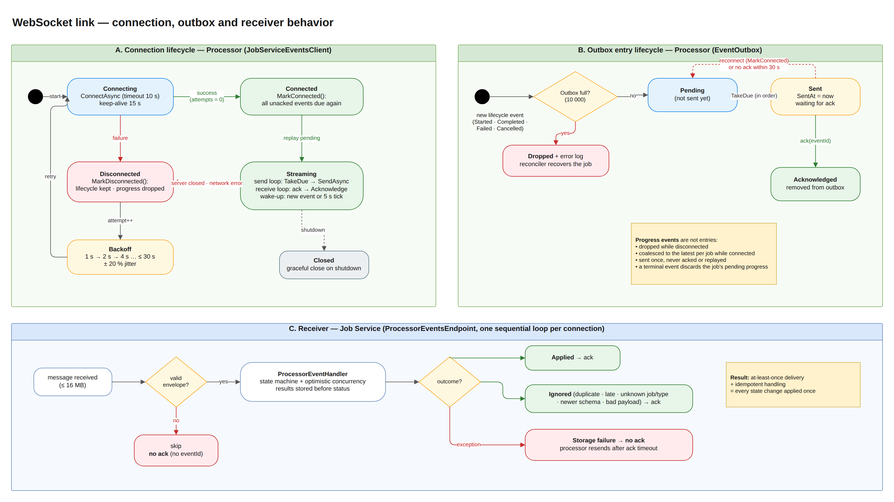

# WebSocket Disconnect / Reconnect Behavior — TA9 Document Processing System

| | |
|---|---|
| **Assignment sections** | §3.3 WebSocket Events · §5 Reliability ("For WebSocket disconnections and duplicate events, choose a sensible behavior and document it") · §8 README item "WebSocket disconnect/reconnect behavior" |
| **Link** | Processor Service (WebSocket **client**) → Job Service endpoint `ws://<job-service>/ws/processor-events` (WebSocket **server**) |
| **Chosen behavior** | **At-least-once delivery** of lifecycle events (bounded outbox + acknowledgements + automatic reconnect with exponential backoff and jitter) combined with **idempotent handling** on the receiver, plus a **reconciler** as a safety net. Progress events are best effort |
| **Diagrams** | draw.io pages **9. WebSocket — Connection & Outbox** and **5c. Sequence — WebSocket Reconnect** in `docs/hld/diagrams/ta9-hld.drawio` |

## 1. Context

The processor reports each job's lifecycle to the Job Service over one persistent WebSocket connection:

| Event | Payload | Importance |
|---|---|---|
| `JobStarted` | total documents | lifecycle: must arrive |
| `JobProgress` | processed / total documents | informational: may be skipped |
| `JobCompleted` | summary + results of every document | lifecycle: must arrive |
| `JobFailed` | error code + reason | lifecycle: must arrive |
| `JobCancelled` | — | lifecycle: must arrive |

Every message is a JSON envelope `{ schemaVersion, eventId, type, jobId, occurredAt, correlationId, payload }`. The Job Service answers each handled event with `{ "type": "Ack", "eventId": "…" }`.

A WebSocket can break at any time: network failure, Job Service restart or deployment, processor restart, or a proxy closing idle connections. A successful `SendAsync` only means the bytes reached the local TCP buffer; it proves nothing about whether the Job Service received or stored the event. The design must therefore answer three questions: **what is resent, when, and what happens when something arrives twice**.

## 2. What we implemented

### 2.1 Processor side: connection management (`JobServiceEventsClient`)

A background service keeps exactly one connection open and repairs it when it breaks (diagram part A).

| Behavior | Detail |
|---|---|
| **Connect** | `ClientWebSocket.ConnectAsync` with a 10 s timeout; header `X-Processor-Id` identifies the instance in the Job Service logs |
| **Keep-alive** | WebSocket ping every 15 s on both sides, so idle connections are not silently dropped by proxies and dead peers are detected |
| **Two loops per connection** | one **send loop** (the only writer: `WebSocket` allows one concurrent send) and one **receive loop** that reads acks. Whichever stops first ends the connection; the other is cancelled, the socket is closed gracefully and then aborted, so no loop can hang |
| **Wake-up** | the send loop sleeps until a new event is added to the outbox, or every 5 s to resend events whose ack timed out. No busy polling |
| **Reconnect** | on any failure: exponential backoff **1 s → 2 s → 4 s … capped at 30 s, ±20% jitter**. The attempt counter resets after a successful connect. The jitter keeps many processors from reconnecting in lockstep (thundering herd) |
| **On (re)connect** | `MarkConnected()` makes **every unacknowledged lifecycle event due again**: they are replayed in their original order before new events |
| **On disconnect** | `MarkDisconnected()` keeps lifecycle events and **drops pending progress** (stale by the time the link is back) |
| **Health** | `/health/ready` reports **Degraded** (HTTP 200) while disconnected: the processor keeps accepting and processing work, and its events are buffered |
| **Shutdown** | graceful close of the socket; the background service stops promptly |

### 2.2 Processor side: what is kept and resent (`EventOutbox`)

Diagram part B.

| Event kind | Behavior |
|---|---|
| **Lifecycle** (`JobStarted`, `JobCompleted`, `JobFailed`, `JobCancelled`) | Added to an ordered, bounded outbox (10,000 events). States: **Pending → Sent → Acknowledged (removed)**. A *Sent* event becomes *Pending* again on reconnect, or when no ack arrives within **30 s** (ack timeout), even without a disconnect |
| **Progress** (`JobProgress`) | Never stored for retry: **coalesced** to the latest value per job, **dropped while disconnected**, sent once, never acknowledged. A terminal event discards the job's pending progress |
| **Outbox full** | The new lifecycle event is dropped with an error log; the publisher never blocks or throws. The Job Service reconciler recovers the job's state (§2.5) |

### 2.3 Job Service side: receiving and acknowledging (`ProcessorEventsEndpoint`)

Diagram part C.

| Behavior | Detail |
|---|---|
| **One sequential loop per connection** | events of one processor are handled one at a time, **in the order they were sent**, with no locks |
| **Ack after handling** | the ack is sent only after the event has been persisted, or deliberately ignored. This is what makes the processor's outbox meaningful |
| **Ignored events are acked too** | duplicates, late events, unknown jobs, unknown event types, newer schema versions and malformed payloads can never change state; acking them stops useless resends |
| **Storage failure → no ack** | if MongoDB is unavailable the handler throws and the event is **not** acknowledged; the processor resends it after the ack timeout. The connection stays open |
| **Unreadable message** | no `eventId` to acknowledge → skipped; the connection keeps working |
| **Protection** | messages above 16 MB close the connection (`MessageTooBig`); a `JobCompleted` for 1,000 documents is about 0.5 MB |
| **Shutdown / client gone** | the loop ends on the request-aborted or application-stopping token; the processor reconnects to the next instance |

### 2.4 Duplicates and ordering: idempotent handling (`ProcessorEventHandler`)

At-least-once delivery means an event can arrive more than once, for example when the ack was lost or the ack timeout fired while the event was being stored. Every event is therefore safe to apply twice:

| Mechanism | Effect |
|---|---|
| **Job state machine** | only legal transitions are applied: `JobStarted` after `Completed` and anything after `Cancelled` are no-ops |
| **Monotonic progress** | `processedDocuments = max(current, incoming)`: an older progress value never moves it backwards |
| **Idempotent results** | results are upserted by `(jobId, index)`; a replayed `JobCompleted` finds the job already terminal and changes nothing |
| **Optimistic concurrency** | every write checks the job version, so a replay racing with the dispatcher, reconciler or a cancel can never overwrite a newer state |
| **Pending race** | an event for a job still `Pending` (the processor finished before the dispatcher recorded its 202) first moves it to `Queued`, then applies |
| **Schema version** | an envelope with a newer `schemaVersion` is acked and ignored (forward compatible) |

**Result: at-least-once delivery + idempotent handling = every state change is applied exactly once.**

### 2.5 Safety net: the reconciler

The outbox lives in the processor's memory. It cannot survive a processor crash, and it can overflow during a very long outage. The Job Service's **reconciler** covers both cases. Every 30 s it looks for `Queued` / `Processing` jobs with no update for 60 s and asks the processor via `GET /api/process/{id}`:
- **Still running:** refresh progress and liveness.
- **Finished:** apply the result through the same handler.
- **Unknown (404, processor restarted):** move the job back to `Pending` and redispatch it (at most 3 times, then `Failed`).

Lost lifecycle events are therefore recovered within about 60–90 s.

### 2.6 Scenario walkthrough

| Scenario | What happens | Outcome |
|---|---|---|
| Short network drop | Processor detects the closed socket, backs off 1 s, reconnects, replays unacked events | No event lost; duplicates ignored |
| Job Service restart / redeploy | Same as above; the reconnect delay grows up to 30 s while the service is down; processing continues and events accumulate in the outbox | Everything is delivered after restart |
| Ack lost (event stored, ack not received) | Event is resent on reconnect or after 30 s; handler recognizes it as a duplicate and acks | State unchanged, outbox cleared |
| MongoDB down while events arrive | Handler throws, no ack; processor resends every 30 s | Applied as soon as MongoDB is back |
| Processor crash | Outbox and in-flight work are lost; reconciler finds the job missing (404) and redispatches it | Job completes on the restarted processor |
| Very long outage (outbox full) | New lifecycle events are dropped and logged; the reconciler later pulls each job's status | Jobs converge to the processor's state |
| Malformed message | Skipped (no `eventId`) or acked and ignored (bad payload) | Connection keeps working |
| Out-of-order delivery (e.g. replay after a newer event) | State machine and monotonic progress reject regressions | No state goes backwards |

## 3. Why this approach

### 3.1 Advantages

| # | Advantage | Explanation |
|---|---|---|
| A1 | **No lost lifecycle events across disconnects** | Acks tell the processor exactly what the Job Service stored; everything else is resent. TCP success alone could not provide this. |
| A2 | **Duplicates are harmless by construction** | Idempotency comes from the job state itself (state machine, monotonic progress, upserts, versioning), so no deduplication table or sequence store is needed. |
| A3 | **Survives restarts on either side** | Job Service restart → replay from the outbox; processor restart → reconciler. Neither requires manual intervention. |
| A4 | **Ordered, lock-free handling** | One sequential loop per connection preserves the sender's order without locking. |
| A5 | **Bounded resources** | The outbox is bounded (10,000), progress is coalesced per job, messages are capped at 16 MB, and reconnect delay is capped at 30 s. A long outage cannot exhaust memory or flood the network. |
| A6 | **Graceful degradation** | While disconnected the processor keeps working and reports Degraded rather than Unhealthy, so orchestration does not kill or stop routing to a healthy worker. |
| A7 | **No reconnect storms** | Exponential backoff with jitter spreads reconnects of many processors. |
| A8 | **Correct under storage outages** | "No ack on failure" turns a MongoDB outage into a delay, never into data loss. |
| A9 | **Forward compatible** | The schema version in the envelope lets a newer processor talk to an older Job Service without breaking it. |
| A10 | **Simple, dependency-free, testable** | Plain `ClientWebSocket` / ASP.NET Core WebSockets and a small outbox class. Every rule is covered by unit tests and real-WebSocket tests (§5). |

### 3.2 Alternatives considered

| Alternative | Why not |
|---|---|
| **Fire-and-forget** (send, no ack, no resend) | Events sent just before a disconnect are silently lost; jobs would stay `Processing` until a timeout. |
| **Reconnect only, rely on the reconciler** | Correct but slow: every disconnect would delay status updates by 60–90 s. The outbox makes the common case immediate; the reconciler stays as the rare-case net. |
| **Durable outbox in the processor (database)** | Survives processor crashes, but adds a database to a stateless worker and a second source of truth. The reconciler already covers crashes. |
| **Deduplication table by `eventId`** | Extra storage and cleanup; unnecessary because handlers are idempotent by design. |
| **Per-job sequence numbers** | Strict ordering per job, but adds sequence tracking on both sides; monotonic progress and the state machine already reject regressions. |
| **SignalR** | Automatic reconnect, but no delivery guarantee for messages sent while disconnected, plus an extra protocol and dependency. Acks and replay would still be needed. |
| **Message broker** (RabbitMQ/Kafka) | Durable, ordered delivery: the right choice at scale, but explicitly out of scope, and the assignment asks for WebSocket communication. |
| **HTTP callbacks instead of WebSocket** | Simpler retries, but one request per event and no persistent channel, which goes against the assignment's WebSocket requirement. |

## 4. Limitations

| # | Limitation | Impact | Mitigation / next step |
|---|---|---|---|
| L1 | **Outbox is in memory** | A processor crash loses its unacknowledged events | Reconciler recovers within ~60–90 s; a durable outbox or broker removes the gap |
| L2 | **Bounded outbox drops when full** | After ~10,000 unacked lifecycle events (a very long outage) new events are dropped | Logged as errors; reconciler recovers; capacity is configurable |
| L3 | **Duplicates do reach the receiver** | Extra handler work and log lines on replays | Handlers are idempotent; cost is a version check per duplicate |
| L4 | **Progress may be skipped** | Clients can miss intermediate progress values during a disconnect | By design: the next progress or the terminal event carries the latest state |
| L5 | **Up to ~30 s added latency after an ack loss** | An event whose ack was lost is resent only on reconnect or after the 30 s ack timeout | Ack timeout is configurable; normal operation is unaffected |
| L6 | **One connection per processor, one Job Service instance** | All events of a processor flow through one socket into one instance | Multi-instance Job Service would need a load balancer with any-instance handling (already idempotent) or a broker |
| L7 | **No authentication on the WebSocket** | Any client that can reach the endpoint could send events | Out of scope by assignment; production: mTLS or a signed token on connect |
| L8 | **Large completion messages** | ~0.5 MB per 1,000-document `JobCompleted`; a replay resends the whole payload | Fine at this scale; for larger jobs send a summary and let the Job Service pull results via REST |

## 5. Tests for this section

The complete catalog of the system's tests, with strategy, environment, traceability and results, is the **Software Test Description (STD)** — `docs/testing/TA9-STD.docx` (Markdown: `docs/testing/STD.md`). This chapter lists only the tests that verify **the WebSocket disconnect / reconnect and duplicate-event behavior (§3.3 and §5 of the assignment)**. The **STD ID** column is the identifier of the same test case in the STD, so each test can be looked up there; *Theory ×N* runs N data rows, *×2 stores* runs against InMemory and MongoDB.
Tests of the other §5 scenarios (invalid input, processor unreachable, storage outage) are traced in the STD under requirements **R8**, **R9** and **R14**.

### 5.1 What is verified

| Behavior described in this document | Verified by |
|---|---|
| Lifecycle events are kept until acked, resent after reconnect or ack timeout; progress coalesced/dropped | `EventOutboxTests`, `WebSocketJobEventPublisherTests` |
| Real reconnect over a WebSocket: buffering while unreachable, replay after a drop, resend on ack timeout | `JobServiceEventsClientTests` (real WebSocket against a fake Job Service) |
| Reconnect backoff grows exponentially with jitter | `ExponentialBackoffTests` |
| The wire contract (envelope, enums, ack) is stable | `ProcessorEventSerializerTests` |
| Ack only after handling; duplicates and unknown jobs acked; storage failure not acked; order per connection | `ProcessorEventsEndpointTests` (real WebSocket against the endpoint) |
| Duplicates, replays and out-of-order events never change state twice or move it backwards | `ProcessorEventHandlerTests` |
| Events lost despite the outbox are recovered by the reconciler | `JobReconcilerTests` |
| End to end, including a processor that dies mid-job and a new instance that reconnects | `EndToEndTests` |

### 5.2 Automated tests

| STD ID | Test case | Test class | Level | Kind |
|---|---|---|---|---|
| PS-078 | Rejects lifecycle events beyond capacity | `EventOutboxTests` | Unit | Fact |
| PS-079 | Takes unsent events in order only once | `EventOutboxTests` | Unit | Fact |
| PS-080 | Resends events whose ack timed out | `EventOutboxTests` | Unit | Fact |
| PS-081 | Acknowledge removes the event | `EventOutboxTests` | Unit | Fact |
| PS-082 | Reconnect makes unacknowledged events due again | `EventOutboxTests` | Unit | Fact |
| PS-083 | Lifecycle events are buffered while disconnected | `EventOutboxTests` | Unit | Fact |
| PS-084 | Progress is dropped while disconnected | `EventOutboxTests` | Unit | Fact |
| PS-085 | Progress is coalesced to the latest per job and not kept for ack | `EventOutboxTests` | Unit | Fact |
| PS-086 | Terminal event discards pending progress of the job | `EventOutboxTests` | Unit | Fact |
| PS-087 | Disconnect discards pending progress | `EventOutboxTests` | Unit | Fact |
| PS-088 | Wait for work completes when an event is added | `EventOutboxTests` | Unit | Fact |
| PS-089 | Delivers events in order and clears outbox on ack | `JobServiceEventsClientTests` | Component | Fact |
| PS-090 | Buffers events until the job service becomes reachable | `JobServiceEventsClientTests` | Component | Fact |
| PS-091 | Replays unacknowledged events after reconnect | `JobServiceEventsClientTests` | Component | Fact |
| PS-092 | Resends when ack times out without reconnect | `JobServiceEventsClientTests` | Component | Fact |
| PS-093 | Sends progress while connected without waiting for ack | `JobServiceEventsClientTests` | Component | Fact |
| SD-012 | Grows exponentially up to the cap with jitter | `ExponentialBackoffTests` | Unit | Theory ×6 |
| SD-013 | Jitter spreads retries | `ExponentialBackoffTests` | Unit | Fact |
| PS-070 | Envelope round trips with typed payload | `ProcessorEventSerializerTests` | Unit | Fact |
| PS-071 | Uses camel case and string enums on the wire | `ProcessorEventSerializerTests` | Unit | Fact |
| PS-072 | Ack round trips | `ProcessorEventSerializerTests` | Unit | Fact |
| PS-073 | Non ack messages are ignored | `ProcessorEventSerializerTests` | Unit | Theory ×3 |
| PS-074 | Lifecycle events are queued with job metadata | `WebSocketJobEventPublisherTests` | Unit | Fact |
| PS-075 | Completed event carries summary and results | `WebSocketJobEventPublisherTests` | Unit | Fact |
| PS-076 | Progress is dropped while disconnected | `WebSocketJobEventPublisherTests` | Unit | Fact |
| PS-077 | Full outbox does not throw | `WebSocketJobEventPublisherTests` | Unit | Fact |
| JS-137 | Handled events are acknowledged and applied | `ProcessorEventsEndpointTests` | Component | Fact |
| JS-138 | Duplicates and unknown jobs are acknowledged too | `ProcessorEventsEndpointTests` | Component | Fact |
| JS-139 | Unreadable message is skipped and the connection keeps working | `ProcessorEventsEndpointTests` | Component | Fact |
| JS-140 | Events are processed in order per connection | `ProcessorEventsEndpointTests` | Component | Fact |
| JS-141 | Plain http request is rejected | `ProcessorEventsEndpointTests` | Component | Fact |
| JS-142 | Event that cannot be stored is not acknowledged | `ProcessorEventsEndpointTests` | Component | Fact |
| JS-095 | Started moves a queued job to processing | `ProcessorEventHandlerTests` | Unit | Fact |
| JS-096 | Events arriving before the dispatcher recorded the 202 still apply | `ProcessorEventHandlerTests` | Unit | Fact |
| JS-097 | Progress is recorded and never goes backwards | `ProcessorEventHandlerTests` | Unit | Fact |
| JS-098 | Completed stores results then completes the job | `ProcessorEventHandlerTests` | Unit | Fact |
| JS-099 | Replayed completion is ignored | `ProcessorEventHandlerTests` | Unit | Fact |
| JS-100 | Late completion of a cancelled job is ignored and stores no results | `ProcessorEventHandlerTests` | Unit | Fact |
| JS-101 | Out of order started after completed is ignored | `ProcessorEventHandlerTests` | Unit | Fact |
| JS-102 | Failed records code and reason | `ProcessorEventHandlerTests` | Unit | Fact |
| JS-103 | Unknown job is ignored | `ProcessorEventHandlerTests` | Unit | Fact |
| JS-104 | Unknown event type is ignored | `ProcessorEventHandlerTests` | Unit | Fact |
| JS-105 | Newer schema version is ignored | `ProcessorEventHandlerTests` | Unit | Fact |
| JS-106 | Malformed payload is ignored not retried | `ProcessorEventHandlerTests` | Unit | Fact |
| JS-107 | Storage failure propagates so the event is not acknowledged | `ProcessorEventHandlerTests` | Unit | Fact |
| JS-074 | Lost completion event is recovered with results | `JobReconcilerTests` | Unit | Fact |
| JS-075 | Lost failure event is recovered | `JobReconcilerTests` | Unit | Fact |
| JS-076 | Job lost by a restarted processor is redispatched | `JobReconcilerTests` | Unit | Fact |
| JS-077 | Job lost too many times fails | `JobReconcilerTests` | Unit | Fact |
| JS-079 | Event arriving during reconciliation wins over redispatch | `JobReconcilerTests` | Unit | Fact |
| E2E-001 | Job flows through processor websocket and audit | `EndToEndTests` | Integration (E2E) | Fact |
| E2E-004 | Job lost by a processor restart is redispatched and completes | `EndToEndTests` | Integration (E2E) | Fact |

All automated tests listed here passed in the latest full run (440 / 440, 2026-10-27).

### 5.3 Manual test (Docker Desktop) — STD MT-07

| Step | Command | Expected |
|---|---|---|
| 1 | Start the stack: `docker compose up -d` (or `scripts/docker-up-prebuilt.ps1`) | All containers healthy |
| 2 | Start a long run: `powershell -ExecutionPolicy Bypass -File .\scripts\smoke-test.ps1 -Jobs 10 -Documents 1000` | Jobs start processing |
| 3 | `docker compose restart job-service` while jobs run | — |
| 4 | `docker compose logs -f processor-service` | `Job Service events connection failed (attempt N)` with growing delays, then `Connected to Job Service events endpoint … N events pending` |
| 5 | `GET /api/jobs?status=Completed` | Every job Completed; nothing lost |
| 6 | `curl.exe http://localhost:5002/health/ready` during step 3 | `Degraded` while disconnected, `Healthy` after reconnect |

Status in the STD: *Not yet executed*.

## 6. Configuration

| Setting (environment variable) | Default | Meaning |
|---|---|---|
| `JobServiceEvents__Url` | `ws://localhost:5001/ws/processor-events` | Job Service WebSocket endpoint |
| `JobServiceEvents__OutboxCapacity` | 10000 | Max lifecycle events waiting for an ack |
| `JobServiceEvents__AckTimeout` | 00:00:30 | Resend a sent event if no ack arrives in this time |
| `JobServiceEvents__ResendCheckInterval` | 00:00:05 | How often the send loop wakes up to check ack timeouts |
| `JobServiceEvents__ReconnectInitialDelay` | 00:00:01 | First reconnect delay |
| `JobServiceEvents__ReconnectMaxDelay` | 00:00:30 | Reconnect delay cap |
| `JobServiceEvents__ConnectTimeout` | 00:00:10 | Connect attempt timeout |
| `JobServiceEvents__KeepAliveInterval` | 00:00:15 | Client ping interval (the server also pings every 15 s) |
| `Reconcile__StaleAfter` / `Reconcile__Interval` | 60 s / 30 s | Safety net for events lost despite the outbox |
